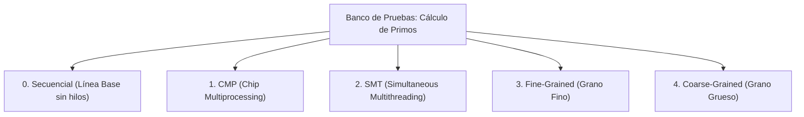
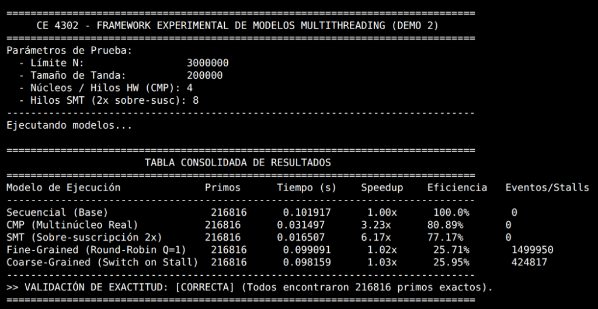

# CE 4302 — Arquitectura de Computadores II
## Proyecto Grupal 1
### Rama de Evaluación: `demostracion2/avance2`

**Instituto Tecnológico de Costa Rica (TEC)**  
**Escuela de Ingeniería en Computadores**  
**Semestre II - 2026**

**Integrantes del Grupo:**
* Emanuel Chavarría Hernández
* Mauricio Navarro Obando
* Yonathan Monge Sanabria
* Fernando Fuchs Mora

---

> **Aviso de Congelamiento de Código (Code Freeze / Entrega):**  
> Esta rama (`demostracion2/avance2`) dejará de ser editada antes de la **1:00 p.m. del jueves 24 de septiembre de 2026** para garantizar la integridad y estabilidad de los entregables a evaluar en la Demostración 2.

---

## Propósito de esta Rama

Esta rama (`demostracion2/avance2`) ha sido preparada específicamente para la presentación y evaluación de la **Demostración 2 (Avance 2 - Semana 8)** del curso, conforme a las especificaciones oficiales y los lineamientos del profesor:

1. **Diagramas de las soluciones esquematizadas preliminares:** Identificación de la arquitectura general y los cambios más significativos frente a las implementaciones base secuenciales .2. **Ejecución de los sistemas base:** Código fuente base funcional sin hilos,.3. **Identificación de variables críticas del problema:** Marcadas formalmente en los archivos de código fuente como comentarios que delimitan los puntos exactos de paralelización.
4. **Propuestas de diseño detalladas y comparadas:** Al menos 2 alternativas de descomposición de trabajo evaluadas bajo criterios técnicos y de arquitectura .5. **Ejecución Dummy de cada esquema multihilo:** Implementación experimental en [`test_cases/`](test_cases/) que modela y contrasta los 4 esquemas requeridos (**CMP**, **SMT**, **Fine-Grained** y **Coarse-Grained**) con cálculo automático de *Speedup*, *Eficiencia Paralela* y validación de exactitud.

---

## Espacios de Problemas por Integrante

Cada problema seleccionado cuenta con su propio módulo independiente, código fuente, documentación y análisis de propuestas para este avance. Puede acceder directamente a la documentación de cada uno mediante los siguientes hipervínculos:

| Problema | Responsable | Espacio / Documentación |
| :--- | :--- | :--- |
| **Ray Tracing** | Emanuel Chavarría Hernández | [`RayTracing/README.md`](proyecto1/problems/echavarria/RayTracing/README.md) |
| **Fractales C++** | Mauricio Navarro Obando | [`fractal-cpp/README.md`](proyecto1/problems/mnavarro/fractal-cpp/README.md) |
| **Heat 2D** | Yonathan Monge Sanabria | [`heat2d/README.md`](proyecto1/problems/heat2d/README.md) |
| **Gray-Scott** | Fernando Fuchs Mora | [`gray-scott/README.md`](proyecto1/problems/gray-scott/README.md) |

---

## anco de Pruebas Dummy Multithreading (`test_cases/`)

PS implementó en [`test_cases/main.cpp`](test_cases/main.cpp) un banco de pruebas experimental sobre el algoritmo de **criba segmentada de números primos**.

### ¿Por qué este problema?
El cálculo de primos por tandas seguras ($\sqrt{\text{fin}} \le \text{inicio} - 1$) permite que la comprobación de candidatos dentro de cada tanda sea **100% independiente y paralelizable**, convirtiéndose en el entorno ideal para contrastar los 4 modelos de ejecución arquitectónicos sin el costo computacional extra.

---

### Los 4 Modelos Multithreading Implementados



1. **Secuencial (Base de Comparación):**  
   Ejecución estrictamente lineal sobre 1 núcleo para obtener el tiempo base $T_{\text{sec}}$ y la cantidad exacta de primos como patrón de validación.
2. **CMP (Chip Multiprocessing - Paralelismo Real):**  
   Implementación con $P$ hilos nativos de C++ (`std::thread`) vinculados directamente a núcleos físicos independientes ($P = 4$). Cada hilo procesa un subrango continuo sin contención (*lock-free*), logrando aceleración real por hardware.
3. **SMT (Simultaneous Multithreading / Hyper-Threading):**  
   Aproximación por **sobre-suscripción** ($2P = 8$ hilos lógicos compitiendo sobre 4 cores físicos), modelando la compartición de pipelines y unidades funcionales (ALUs/FPUs) en el procesador.
4. **Fine-Grained (Multihilo de Grano Fino):**  
   Planificación cooperativa en anillo (*round-robin*) con **quantum mínimo ($Q = 1$ número)**. El planificador conmuta incondicionalmente de hilo en cada paso sin importar si hubo bloqueo, registrando el número masivo de conmutaciones de contexto.
5. **Coarse-Grained (Multihilo de Grano Grueso):**  
   Ejecución continua por ráfagas. El cambio de contexto ocurre **únicamente ante un evento de bloqueo/stall costoso** (modelado cuando la verificación de primalidad supera un umbral de $\ge 15$ divisiones sucesivas, simulando una latencia alta en memoria caché).

---

### Compilación y Ejecución del Dummy

```bash
cd test_cases
g++ -O3 -std=c++17 main.cpp -o primos -pthread
./primos
```

*(Opcional: se pueden especificar parámetros personalizados `./primos [límite_N] [tamaño_tanda] [hilos]`, ej: `./primos 3000000 200000 4`)*.

---

### Resultados y Captura de Métricas

A continuación se presenta la evidencia de ejecución del programa `primos`, mostrando la tabla comparativa con los tiempos medidos, el **Speedup** ($S = T_{\text{sec}} / T_{\text{par}}$), la **Eficiencia** ($E = S / \text{hilos}$) y la validación de exactitud:

#### Salida de Terminal:
`#### Captura de Pantalla del Benchmark Dummy:



---

## 🗂 Organización del Repositorio

La arquitectura de directorios del proyecto se organiza de la siguiente manera:

```text
mnavarro_ymonge_echavarria_ffuchs_a2_2026_s2/
├── README.md                              # Este documento (Portal principal del Avance 2)
├── .gitignore                             # Reglas de exclusión de Git del repositorio
│
├── proyecto1/
│   ├── common/                            # Módulos compartidos y utilidades de benchmarking
│   │   ├── benchmark/                     # Temporizadores e instrumentación de métricas
│   │   ├── include/                       # Encabezados comunes del framework
│   │   └── src/                           # Implementaciones compartidas
│   │
│   ├── problems/                          # Directorio de los 4 problemas del proyecto
│   │   │
│   │   ├── echavarria/                    # Módulo de Emanuel Chavarría
│   │   │   └── RayTracing/                # Trazador de rayos 3D (C++17, CMake)
│   │   │       ├── README.md              # Guía de evaluación del problema de Ray Tracing
│   │   │       ├── main.cpp               # Punto de entrada y parámetros de la escena
│   │   │       ├── src/                   # Cámara, materiales, objetos y vectores 3D
│   │   │       └── docs/                  # Propuestas.md y diagramas arquitectónicos
│   │   │
│   │   ├── mnavarro/                      # Módulo de Mauricio Navarro
│   │   │   └── fractal-cpp/               # Generador de fractales en C++
│   │   │       ├── README.md              # Documentación y guía del problema de fractales
│   │   │       ├── app/ / src/            # Lógica de cálculo matemático y generación
│   │   │       └── include/ / docs/       # Estructuras de datos y diseño
│   │   │
│   │   ├── heat2d/                        # Módulo de Yonathan Monge
│   │   │   ├── README.md                  # Documentación de difusión de calor 2D
│   │   │   ├── src/                       # Modelos computacionales y núcleo de simulación
│   │   │   └── include/ / tests/          # Grids, condiciones iniciales y tests de estrés
│   │   │
│   │   └── gray-scott/                    # Módulo de Fernando Fuchs
│   │       ├── README.md                  # Documentación de simulación Gray-Scott
│   │       ├── sequential/                # Implementación base secuencial
│   │       ├── src/ / include/            # Núcleo cinético y estructuras de grilla
│   │       └── docs/                      # Propuestas.md y documentación asociada
│   │
│   └── scripts/                           # Scripts de automatización y ejecución
│
└── test_cases/                            # Banco de pruebas experimental multithreading
    ├── main.cpp                           # Implementación de los 4 modelos (CMP, SMT, Fine, Coarse)
    └── dummy_metricas.png                 # Captura de pantalla de la ejecución y resultados
```
