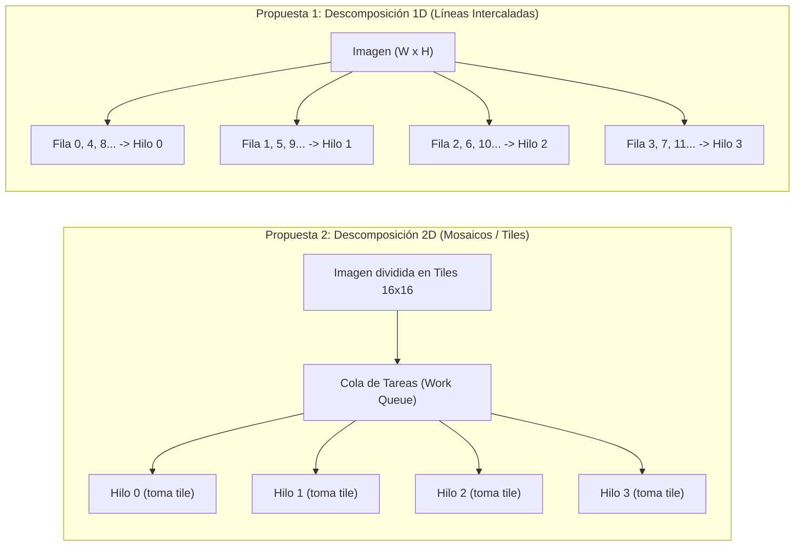

# Propuestas de Diseño de Paralelización (Ray Tracing)

## 1. Propuesta 1: Descomposición 1D por Líneas de Escaneo (Scanlines)

* **Descripción:**  
  La imagen se particiona horizontalmente. La asignación de filas a los hilos de trabajo se realiza de manera estática.
* Mapeo estático. No requiere locks, semáforos ni variables atómicas en tiempo de ejecución. Cada hilo conoce  su conjunto de filas.

* **Escritura en memoria:**  
  Cada hilo escribe de forma independiente en su región de memoria contigua en el `Framebuffer`  
 

## 2. Propuesta 2: Descomposición 2D por Mosaicos Dinámicos (Dynamic 2D Tiles)

* **Descripción:**  
  El plano de la imagen se divide en una cuadrícula de bloques bidimensionales de tamaño uniforme (por ejemplo, mosaicos de $16 \times 16$ píxeles). El conjunto de todos los mosaicos conforma una cola de trabajo (*Work Queue*).

* **Mecanismo de sincronización:**  
  Asignación dinámica mediante un contador atómico. Cuando un hilo finaliza un mosaico, extrae de inmediato el siguiente bloque disponible en la cola.

* **Escritura en memoria:**  
  Cada hilo escribe el bloque de píxeles procesado en las coordenadas rectangulares correspondientes dentro del `Framebuffer`.

---

## 3. Esquema Comparativo de Descomposición

---

## 4. Tabla Comparativa según Criterios de Arquitectura

| Criterio de Evaluación | Propuesta 1: Descomposición 1D (Líneas) | Propuesta 2: Descomposición 2D (Mosaicos / Tiles) |
| :--- | :--- | :--- |
| **Balance de Carga** | **Deficiente:** En escenas 3D heterogéneas, las filas inferiores (con suelo, esferas de vidrio y reflexiones) requieren hasta 50 rebotes por rayo, mientras que las superiores terminan en 1 rebote. Se producen hilos ociosos mientras otros continúan saturados. | **Excelente:** La asignación dinámica mitiga el desbalance. Los hilos que procesan bloques de baja densidad computacional terminan rápido y toman automáticamente nuevos bloques de zonas complejas, manteniendo alta ocupación de CPU. |
| **Localidad Espacial y Caché (L1/L2)** | **Regular:** Rayos contiguos verticalmente se distribuyen en núcleos distintos, disminuyendo la reutilización de líneas de caché de los objetos y materiales de la escena. | **Mejor:** Un bloque de $16 \times 16$ proyecta rayos espacialmente muy cercanos en el espacio 3D, lo que maximiza la tasa de aciertos (*cache hits*) en L1/L2 |

---

## 5. Selección y Justificación del Diseño

Se selecciona la **Propuesta 2 (Mosaicos 2D Dinámicos)** como la solución arquitectónica principal debido a su **naturaleza ** 
.
