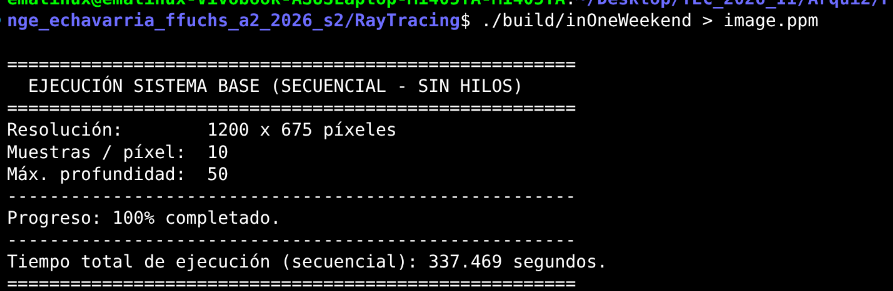
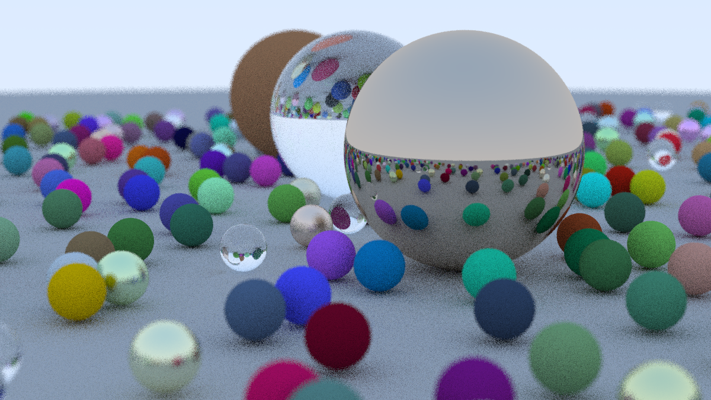

# Ray Tracing — Guía de Evaluación (Avance 2 / Demostración 2)
**CE 4302 — Arquitectura de Computadores II**  
**Instituto Tecnológico de Costa Rica (TEC)**  
**Semestre II - 2026**

---

## esumen de Navegación Rpara Demostración 2.Esta guía orienta al profesor y evaluadores para localizar de forma inmediata cada uno de los requerimientos solicitados para la **Demostración 2 (Semana 8)**:

| # | Requerimiento de la Evaluación | Ubicación en el Repositorio | Descripción Breve |
|---|---|---|---|
| **1** | **Identificación en código** de variables y puntos de paralelización | [`src/camera.h`](src/camera.h) y [`main.cpp`](main.cpp) | Comentarios inline marcando variables críticas, bucles paralelizables y cuello de botella. |
| **2** | **Diagrama Arquitectónico Preliminar** (Secuencial vs. Paralelo) | [`docs/Secuencial_vs_paralelo.png`](docs/Secuencial_vs_paralelo.png) | Esquema visual del cambio más significativo: desacoplamiento de `std::cout` y uso de `Framebuffer` en RAM. |
| **3** | **2 Propuestas de Diseño comparadas por criterios** | [`docs/Propuestas.md`](docs/Propuestas.md) | Descomposición 1D (Filas) vs. 2D (Mosaicos / Tiles) evaluadas bajo Balance de Carga, Caché L1/L2 y Sincronización.  |
|

---

## 1. Identificación de Variables y Puntos de Paralelización en Código

Los puntos clave fueron documentados de forma directa en el código fuente:

### A. Variables Críticas del Problema
Ubicadas en [`src/camera.h`](src/camera.h) (líneas 20–24):
* **`image_width` e `image_height`:** Determinan el espacio total de tareas independientes ($N = W \times H$).
* **`samples_per_pixel`:** Controla la granularidad de cómputo por píxel (rayos trazados).
* **`max_depth`:** longitud de la cadena de rebotes de rayos.

### B. Puntos de Paralelización (Bucles) y Cuello de Botella
Ubicados en el método `render()` de [`src/camera.h`](src/camera.h) (líneas 45–85):
* **Punto 1 (Bucle `j` - Filas / Scanlines):** Descomposición 1D para CMP y Coarse-Grained.
* **Punto 2 (Bucles `j` e `i` - Píxeles / Mosaicos):** Descomposición 2D por Tiles dinámicos.
* **Punto 3 (Bucle `sample` - Muestras):** Paralelismo de grano fino.
* **Cuello de Botella Identificado:** La escritura directa a consola (`std::cout`) provoca condiciones de carrera (*data race*). Se reemplazará por un arreglo en memoria (`Framebuffer`).

---

## 2. Diagramas y Propuestas de Diseño

Todos los diagramas se encuentran centralizados en la carpeta [`docs/`](docs/):

1. **Diagrama Principal:**  
   [`docs/Secuencial_vs_paralelo.png`](docs/Secuencial_vs_paralelo.png) ilustra la arquitectura de transición: el flujo del render secuencial frente al enfoque paralelo.
2. **Documento de Propuestas Detalladas:**  
   [`docs/Propuestas.md`](docs/Propuestas.md) contiene la especificación formal de:
   * **Propuesta 1:** Descomposición 1D por Líneas de Escaneo.
   * **Propuesta 2:** Descomposición 2D por Mosaicos Dinámicos (*Tiles* de $16 \times 16$).
   * **Tabla Comparativa:** Análisis de Balance de Carga, Localidad de Caché (L1/L2).
   * **Selección del Diseño:** Justificación técnica de la selección de la Propuesta 2.

---

## 3. Instrucciones de Compilación y Ejecución del Sistema Base

El proyecto utiliza CMake (C++17) y cuenta con medición de tiempo en segundos integrada en `std::clog`.

### Compilación:
```bash
cd RayTracing
cmake -B build -S .
cmake --build build
```

### Ejecución Base (Secuencial):
Para ejecutar con la resolución original d 1200 × 675 píxeles, 10 muestras, 50 profundidad):
```bash
./build/inOneWeekend > imagen_base.ppm
```

O para una ejecución de prueba rápida (ej. 200 × 112 píxeles, 5 muestras, 20 profundidad):
```bash
./build/inOneWeekend 200 5 20 > imagen_base.ppm
```

### Ejecución y Output:
Al ejecutar la versión actual del problema, se obtiene la siguiente salida en terminal


Esta ejecución nos da como resultado el siguiente render:


*La imagen generada se almacena en formato estándar `imagen_base.ppm`.*

---

## 4. Estructura de Archivos del Módulo

```text
RayTracing/
├── CMakeLists.txt              # Configuración de compilación CMake (C++17)
├── README.md                   # Este documento (Guía de evaluación para el profesor)
├── main.cpp                    # Punto de entrada, configuración de escena y cámara
├── src/                        # Código fuente del motor de trazado de rayos
│   ├── camera.h                # Cámara, bucles secuenciales, cronómetro e identificación
│   ├── color.h                 # Utilidades de color y formato RGB
│   ├── hittable.h / _list.h    # Objetos intersectables y contenedor de escena
│   ├── material.h              # Materiales │   ├── ray.h / vec3.h          # Álgebra lineal y clase de rayos 3D
│   └── sphere.h / interval.h   # Geometría de esferas e intervalos numéricos
└── docs/                       # Documentación formal para el Avance 2
    ├── Propuestas.md           # Las 2 propuestas de diseño detalladas y tabla comparativa
    └── Secuencial_vs_paralelo.png # Diagrama arquitectónico del sistema
```

