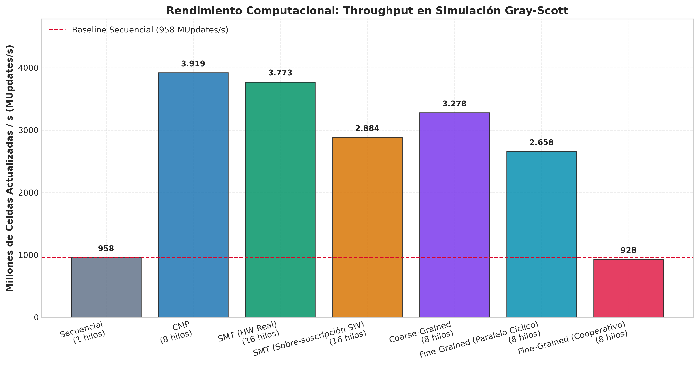
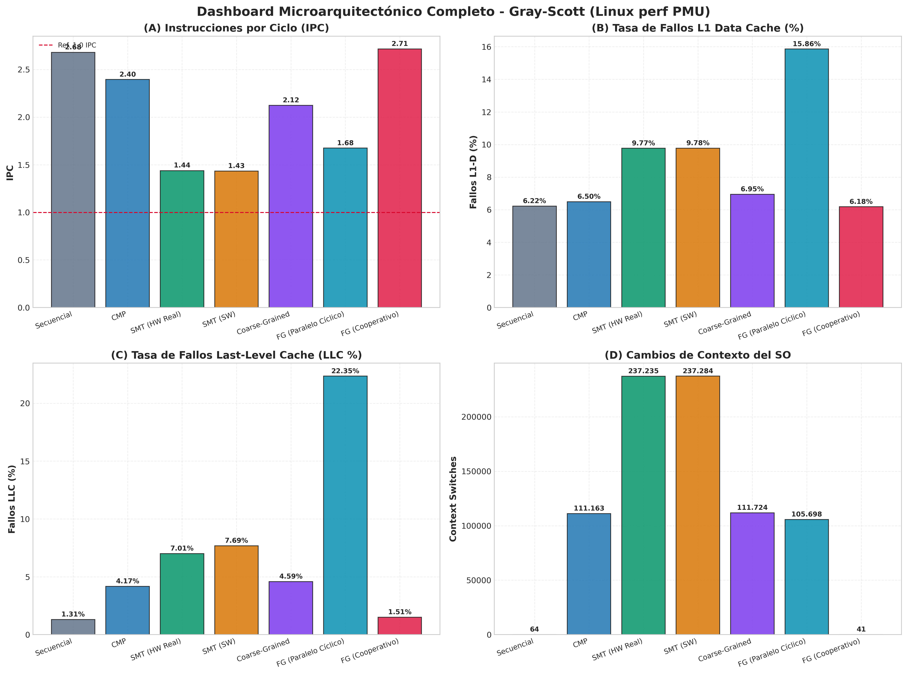

# Documentación del Algoritmo Gray-Scott y Modelos de Paralelización

**CE 4302 — Arquitectura de Computadores II**  
**Instituto Tecnológico de Costa Rica (TEC)**  
**Problema:** Simulación de Reacción-Difusión de Gray-Scott (Proliferación Bacteriana)

---

## 1. Núcleo Computacional Compartido (`gray_scott_core`)

Todo el proyecto se construye sobre un núcleo común desacoplado (`include/gray_scott_core.hpp` y `src/gray_scott_core.cpp`), garantizando que todas las implementaciones utilicen exactamente la misma física, discretización y constantes numéricas:

### A. Estructuras de Datos
* **`Grid2D` (`include/grid.hpp`):**
  Representa el dominio bidimensional de la placa de Petri. Contiene dos vectores continuos en memoria (`std::vector<float> u` y `std::vector<float> v`).
  * **Formato *Row-Major*:** El acceso espacial se realiza linealmente mediante la fórmula $\text{index}(x, y) = y \cdot W + x$.
  * **Beneficio Arquitectónico:** El recorrido secuencial de celdas adyacentes aprovecha las líneas de caché L1/L2 de 64 bytes y activa el *Hardware Prefetcher* del procesador.
* **`GrayScottParams` (`include/gray_scott_core.hpp`):**
  Encapsula las tasas físicas de difusión y reacción:
  * $D_u = 0.2$: Tasa de difusión del sustrato nutriente $U$.
  * $D_v = 0.1$: Tasa de difusión de la bacteria autocatalítica $V$.
  * $F = 0.034$: Tasa de alimentación (*Feed*).
  * $K = 0.065$: Tasa de mortalidad bacteriana (*Kill*).
  * $dt = 1.0$: Paso de avance temporal discreto.

### B. Métodos del Núcleo
* **`init_simulation(Grid2D& grid)`:**  
  Establece el estado inicial: satura el dominio completo con nutriente $U = 1.0, V = 0.0$ e inocula un área cuadrada central de $20 \times 20$ celdas con $U = 0.5, V = 1.0$ como semilla de proliferación bacteriana.
* **`step_simulation_slice(const Grid2D& current, Grid2D& next, int start_y, int end_y, const GrayScottParams& params)`:**  
  **Motor unificado de cálculo del stencil.** Evalúa el esquema de diferencias finitas en el tiempo (FTCS) y el operador Laplaciano de 5 puntos exclusivamente sobre la franja de filas $[y_{\text{start}}, y_{\text{end}})$:
  * **Operador Laplaciano (stencil de 5 puntos):**  
    $\nabla^2 A_{x,y} \approx A_{x+1,y} + A_{x-1,y} + A_{x,y+1} + A_{x,y-1} - 4A_{x,y}$
  * **Reacción autocatalítica:**  
    $R = u \cdot v^2$
  * **Ecuaciones cinéticas acopladas de Gray-Scott:**  
    $\frac{\Delta u}{\Delta t} = D_u \nabla^2 u - R + F(1 - u), \quad \frac{\Delta v}{\Delta t} = D_v \nabla^2 v + R - (F + K)v$
  * Las lecturas se realizan de forma segura y concurrente sobre `current` (solo lectura durante el paso $t$).
  * Las escrituras se realizan de forma disjunta sobre `next`.
* **`export_frame_ppm(const Grid2D& grid, int frame_id, const std::string& output_dir)`:**  
  Serializa el estado de la bacteria $V$ a una imagen PPM ultraligera (formato ASCII P3) mapeando la concentración flotante $[0.0, 1.0]$ al canal de color verde $[0, 255]$ para la posterior generación de video.

---

## 2. Implementación Secuencial (`sequential/main.cpp`)

### Propósito
Constituye la **línea base absoluta ($T_{\text{sec}}$)** y el patrón oro de exactitud numérica para calcular el *Speedup* ($S = T_{\text{sec}} / T_{\text{par}}$) y la *Eficiencia* ($E = S / P$).

### Cómo utiliza el Núcleo (`core`)
1. **Invocación:** Llama a `step_simulation_sequential(current, next, params)`, la cual delega directamente en:
   ```cpp
   step_simulation_slice(current, next, 1, current.height - 1, params);
   ```
   computando todas las filas interiores en un único hilo de CPU.
2. **Intercambio de Búferes:** Al terminar cada paso temporal $t$, ejecuta `std::swap(current, next)`.
3. **Desacoplamiento de Benchmark e I/O:** Separa la toma rigurosa de tiempos de cómputo (`std::chrono::high_resolution_clock`) de la fase de exportación de video, asegurando que las escrituras en disco no contaminen las métricas.

---

## 3. CMP — Chip Multiprocessing (`CMP/main.cpp`)

### Propósito
Implementa **paralelismo real sobre múltiples núcleos físicos independientes**, aislando la ejecución de cualquier interferencia o contención microarquitectónica por hilos lógicos (SMT).

### Cómo utiliza el Núcleo (`core`)
1. **Descomposición de Dominio 1D por Filas:**  
   La grilla de $(H - 2)$ filas interiores se divide en franjas continuas horizontales asignadas a cada hilo de trabajo $\text{id}$ ($0 \le \text{id} < P$):
   * **Fila inicial:** $y_{\text{start}} = 1 + \text{id} \cdot \text{filas}_{\text{base}} + \min(\text{id}, \text{residuo})$
   * **Fila final:** $y_{\text{end}} = y_{\text{start}} + \text{filas}_{\text{base}} + (\text{id} < \text{residuo} \ ? \ 1 : 0)$
   
   donde $\text{filas}_{\text{base}} = \lfloor (H - 2) / P \rfloor$ y $\text{residuo} = (H - 2) \pmod P$.

2. **Cómputo en Paralelo:** Cada hilo trabajador ejecuta de forma aislada e independiente:
   ```cpp
   step_simulation_slice(cur, nxt, ctx->start_y, ctx->end_y, *(ctx->params));
   ```
   * Al escribir en filas disjuntas y continuas, se elimina por completo el **Falso Compartimiento (*False Sharing*)**, ya que las fronteras distan miles de bytes entre sí.

### Métodos y Mecanismos Clave
* **Detección Dinámica de Núcleos (`obtener_cpus_fisicos()`):**  
  Lee `/sys/devices/system/cpu/cpu*/topology/core_id` para obtener la lista ordenada de CPUs que corresponden a núcleos físicos distintos (CPUs $0$ a $7$ en procesadores AMD Zen 3 como Ryzen 7 7730U), evitando asignar dos hilos CMP al mismo núcleo físico.
* **Afinidad por Hardware (`pthread_setaffinity_np`):**  
  Fija cada hilo de ejecución del sistema operativo al núcleo físico que le corresponde.
* **Hilos Persistentes de Larga Duración:**  
  Los $P$ hilos se crean una única vez al inicio con `pthread_create`. Se eliminan las miles de llamadas al sistema `clone()` que ocurrirían si se crearan hilos por iteración.
* **Sincronización por Barrera (`pthread_barrier_t`):**  
  Al final de cada paso temporal, todos los hilos se sincronizan en una barrera POSIX antes de avanzar al paso $t+1$.
* **Doble Búfer Alternado:**  
  La selección de lectura y escritura se determina mediante la paridad del paso:
  ```cpp
  const Grid2D& cur = (step % 2 != 0) ? *grid_A : *grid_B;
  Grid2D& nxt       = (step % 2 != 0) ? *grid_B : *grid_A;
  ```
  Esto erradica punteros compartidos o cerrojos (*locks*).
* **Verificación Numérica Automática (`--verify`):**  
  Ejecuta el problema idéntico en secuencial y compara celda por celda $|U_{\text{cmp}} - U_{\text{seq}}| < 10^{-5}$ y $|V_{\text{cmp}} - V_{\text{seq}}| < 10^{-5}$.

---

## 4. SMT — Simultaneous Multithreading (`SMT/main.cpp`)

### Propósito
Evaluar el comportamiento microarquitectónico de 16 hilos de trabajo compitiendo sobre los 8 núcleos físicos de la CPU bajo dos regímenes de ejecución:
1. **SMT por Hardware Real (`SMT ON`):** Dos hilos lógicos coexisten en el mismo núcleo físico, compitiendo directamente por las unidades de punto flotante (FPUs), puertos de despacho y la memoria caché L1/L2 a nivel de ciclo de reloj.
2. **Sobre-suscripción por Software (`SMT OFF`):** Con SMT apagado en el kernel, solo existen 8 núcleos disponibles, forzando al planificador del sistema operativo a alternar los 16 hilos mediante conmutaciones de contexto por software (*time-slicing*).

### Cómo utiliza el Núcleo (`core`)
1. **Descomposición 1D en 16 Franjas:**  
   Divide las $(H - 2)$ filas interiores entre los 16 hilos lógicos en franjas horizontales continuas:
   * **Fila inicial:** $y_{\text{start}} = 1 + \text{id} \cdot \text{filas}_{\text{base}} + \min(\text{id}, \text{residuo})$
   * **Fila final:** $y_{\text{end}} = y_{\text{start}} + \text{filas}_{\text{base}} + (\text{id} < \text{residuo} \ ? \ 1 : 0)$
2. **Invocación Unificada:**
   Cada hilo ejecuta independientemente:
   ```cpp
   step_simulation_slice(cur, nxt, ctx->start_y, ctx->end_y, *(ctx->params));
   ```
   manteniendo el acceso en orden *Row-Major* y eliminando el falso compartimiento (*false sharing*).

### Métodos y Mecanismos Clave
* **Diagnóstico de Topología en Linux (`obtener_estado_smt_linux()`):**  
  Lee dinámicamente `/sys/devices/system/cpu/smt/control` para detectar si el procesador tiene SMT activo (`on`) o inactivo (`off`).
* **Mapeo de Afinidad Adaptativo (`pthread_setaffinity_np`):**  
  * Con **SMT ON** (16 CPUs online): Asigna el hilo $t$ a la CPU lógica $t$. De esta forma, el Hilo 0 (CPU 0) y el Hilo 8 (CPU 8) se ejecutan físicamente sobre el Core 0 compartiendo hardware.
  * Con **SMT OFF** (8 CPUs online): Asigna el hilo $t$ a la CPU $(t \pmod 8)$. El Hilo 0 y el Hilo 8 quedan enlazados a la misma CPU física 0, obligando al kernel de Linux a realizar *preemptive multitasking* por software.
* **Hilos Persistentes + Barrera:**  
  Los 16 hilos se crean una única vez al inicio y se sincronizan al final de cada paso temporal mediante `pthread_barrier_t`.
* **Reglas Automatizadas en el Makefile:**  
  * `make run_smt`: Ejecuta SMT con los 16 hilos lógicos en hardware real.
  * `make run_smt_sw`: Deshabilita temporalmente SMT en el kernel (`echo off`), ejecuta los 16 hilos en sobre-suscripción, y restaura SMT a `on` de forma segura mediante un manejador `trap` de bash.
  * `make verify_smt`: Comprueba la exactitud matemática contra el secuencial asegurando $|diff| < 10^{-5}$.
  * `make run_smt_video`: Genera el video con superposición de métricas de SMT.

---

## 5. Multihilo de Grano Grueso — Coarse-Grained (`coarse-grained/main.cpp`)

### Propósito
Implementar el modelo arquitectónico de multihilo de grano grueso (*Coarse-Grained / Block Multithreading*), donde los hilos de ejecución tradicionales ejecutan **ráfagas de cómputo continuas y extensas** sobre grandes bloques de datos, y el cambio de contexto o cesión del procesador ocurre **únicamente ante eventos de bloqueo costosos** (como la barrera de sincronización global inter-paso o las operaciones de E/S en disco).

### Cómo utiliza el Núcleo (`core`)
1. **Ráfagas Ininterrumpidas de Cómputo (32,640 celdas por ráfaga/hilo):**
   Cada hilo tradicional recibe un bloque contiguo de filas $[y_{\text{start}}, y_{\text{end}})$ (típicamente $64$ filas en una grilla de $512 \times 512$). El hilo invoca:
   ```cpp
   step_simulation_slice(cur, nxt, ctx->start_y, ctx->end_y, *(ctx->params));
   ```
   ejecutando decenas de miles de evaluaciones de stencil consecutivas sin ceder la CPU, manteniendo las líneas de caché calientes y el pipeline saturado.
2. **Punto Estricto de Conmutación / Bloqueo:**
   El hilo solo se detiene ante eventos de bloqueo de alta latencia:
   * **Barrera Inter-paso:** `pthread_barrier_wait(ctx->barrera)` (exactamente 16,000 eventos de bloqueo en la simulación).
   * **Operación de E/S:** Bloqueo de espera cuando el hilo 0 vuelca un fotograma a disco.

### Métodos y Mecanismos Clave
* **Métricas de Ráfaga y Bloqueo:**
  El programa contabiliza explícitamente:
  * El tamaño de la ráfaga continua (`burst_cells` = $32{,}640$ celdas).
  * El número total de eventos de bloqueo/sincronización (`stall_events` = $16{,}000$).
* **Hilos Persistentes Tradicionales:**  
  Se crean al inicio mediante `pthread_create` y perduran a lo largo de toda la simulación, evitando el overhead del kernel en la creación de procesos o hilos efímeros.
* **Reglas del Makefile:**  
  * `make run_coarse`: Ejecuta el modelo de grano grueso con 8 hilos sobre $512 \times 512$ y $16{,}000$ pasos.
  * `make verify_coarse`: Valida la coherencia numérica celda a celda contra el secuencial ($|diff| < 10^{-5}$).
  * `make run_coarse_video`: Genera el video representativo con las métricas en pantalla.

---

## 6. Multihilo de Grano Fino — Fine-Grained (`fine-grained/main.cpp`)

### Propósito
Modelar y evaluar el comportamiento microarquitectónico de **Multihilo de Grano Fino (*Fine-Grained / Interleaved Multithreading*)**, donde múltiples flujos lógicos o hilos de ejecución rotan de manera **intercalada e incondicional** en cada ciclo de reloj o cuantum mínimo de trabajo (por defecto $Q = 1$ fila), **independientemente de si el hilo en curso sufrió un bloqueo (*stall*) o no**.

En cumplimiento con la especificación del curso (Sección 4.1.a y Nota 4.1.5 que exige comparar al menos 2 propuestas de diseño), se desarrollaron dos enfoques arquitectónicos:

1. **Propuesta 1 — Simulación por Planificación Cooperativa (*User-Space Round-Robin Scheduler*, `--mode cooperative`):**  
   Modela fielmente la microarquitectura de procesadores de grano fino históricos (como el Denelcor HEP o Tera MTA / Cray MTA). Un conjunto de $T$ hilos virtuales rotan estrictamente procesando un cuantum mínimo ($Q = 1$ fila). Cada cuantum fuerza un cambio de contexto formal, permitiendo cuantificar con precisión el número masivo de conmutaciones (más de **8.16 millones** en 16,000 pasos) y el impacto del *scheduling overhead*.
2. **Propuesta 2 — Paralelismo Cíclico Intercalado en Hardware (*Cyclic POSIX Threads*, `--mode parallel`):**  
   Distribuye las filas de la grilla entre $T$ hilos del sistema operativo en modo cíclico ($y \pmod T = id$). Cada hilo procesa fragmentos de 1 fila intercalados espacialmente. Esto permite evidenciar en la práctica la pérdida de localidad espacial en memoria caché L1/L2 y el efecto de contención sobre líneas de caché adyacentes frente al esquema por bloques de Coarse-Grained.

### Cómo utiliza el Núcleo (`core`)
1. **Descomposición Cíclica / Cuantums Mínimos de Fila:**  
   En lugar de bloques continuos grandes, el dominio de filas interiores $[1, H-1)$ se recorre en fragmentos mínimos de longitud $Q$ (por defecto $Q = 1$ fila):
   ```cpp
   step_simulation_slice(cur, nxt, y, y + chunk_size, params);
   ```
   donde `chunk_size = std::min(quantum, (height - 1) - y)`.
2. **Conmutación Incondicional por Cuantum:**  
   Tras completar cada fragmento de 1 fila, el planificador cambia inmediatamente al siguiente hilo lógico:
   ```cpp
   stats[turno_hilo].conmutaciones++;
   total_context_switches++;
   turno_hilo = (turno_hilo + 1) % num_threads;
   ```
   No se espera a ningún fallo de caché o barrera para ceder el turno.

### Métodos y Mecanismos Clave
* **Cuantificación Masiva de Conmutaciones:**  
  Para una grilla de $512 \times 512$ con 510 filas interiores y $16{,}000$ pasos temporales:  
  $\text{Conmutaciones} = 510 \times 16{,}000 = 8{,}160{,}000\text{ cambios de contexto}$.
* **Degradación Teórica en Arquitecturas Modernas de Escritorio:**  
  Los procesadores x86-64 modernos carecen de pipelines de conmutación de registros a nivel de ciclo (como los que tenía el Tera MTA). Por tanto, la alternancia forzada de grano fino evidencia:
  * En modo cooperativo: Desempeño cercano a 1x con sobrecarga de control.
  * En modo paralelo cíclico: Speedup moderado (~3.05x vs 5.04x de CMP) producto de la pérdida de streaming contiguo del prefetcher de hardware y la contención en líneas de caché adyacentes.
* **Reglas del Makefile:**  
  * `make fine`: Compila el binario `gray_scott_fine`.
  * `make run_fine`: Ejecuta el modelo cooperativo por cuantums con 8 hilos virtuales y $Q=1$.
  * `make run_fine_parallel`: Ejecuta la propuesta cíclica paralela con hilos POSIX.
  * `make verify_fine`: Verifica la coherencia matemática celda a celda contra el secuencial ($|diff| < 10^{-5}$).
  * `make run_fine_video`: Genera el video sincronizado con el tiempo medido en CPU.

---

## 7. Infraestructura de Benchmarking Automatizado y Métricas (`scripts/benchmark.py`)

### Propósito
Automatizar la campaña de **200 corridas estadísticas por modelo** sobre la configuración estándar ($512 \times 512$, $16{,}000$ pasos temporales) para obtener muestras científicas robustas y analizar rigurosamente el comportamiento de la CPU sin distorsiones provocadas por el planificador del sistema operativo.

### Arquitectura del Módulo de Métricas
Los resultados y el código de medición se organizan de forma desacoplada:
```text
proyecto1/problems/gray-scott/
├── scripts/
│   ├── benchmark.py              <-- Script maestro en Python 3 (sin dependencias externas)
│   └── Makefile                  <-- Objetivos: make benchmark y make benchmark_fast
└── metricas/                     <-- Carpeta dedicada para reproducibilidad experimental
    ├── gray_scott_benchmark.csv  <-- Datos crudos de las corridas (escritura incremental en disco)
    ├── resumen_estadistico.csv   <-- Estadísticas agregadas (Media, StdDev, Mín, Máx, Speedup)
    └── graficas/                 <-- Directorio reservado para gráficos comparativos (.png / .pdf)
```

### Características Técnicas del Script Maestro (`benchmark.py`)
1. **Escritura Incremental Segura (`flush` continuo):**
   Cada corrida completada se formatea y escribe de inmediato en `gray_scott_benchmark.csv`. Si el proceso se interrumpe, no se pierde ninguna medición previa.
2. **Prevención de *Thermal Throttling* (`--cooldown`):**
   Introduce pausas configurables (por defecto 0.05 s) entre corridas sucesivas para evitar el sobrecalentamiento del silicio del Ryzen y asegurar que las frecuencias de reloj permanezcan estables a lo largo de las 200 iteraciones.
3. **Cero Dependencias de Terceros para Medición:**
   Utiliza exclusivamente módulos estándar de Python (`csv`, `subprocess`, `time`, `statistics`, `argparse`, `pathlib`), permitiendo ejecutar las mediciones en cualquier entorno Linux sin requerir instalación previa de bibliotecas externas.
4. **Métricas Consolidadas:**
   Calcula en tiempo real Media ($\mu$), Desviación Estándar ($\sigma$), Mínimo, Máximo, Mediana, Speedup vs Secuencial y Eficiencia Paralela, exportándolos a `resumen_estadistico.csv`.

### Estructura de Campos en `gray_scott_benchmark.csv`
* `run_id`: Número de iteración (1 a $N$).
* `modelo`: Nombre del modelo (`Secuencial`, `CMP`, `SMT`, `Coarse-Grained`, `Fine-Grained`).
* `modo`: Sub-régimen (`baseline`, `dedicated_cores`, `hardware_smt`, `software_oversubscription`, `burst_block`, `cooperative_quantum`, `cyclic_threads`).
* `hilos`: Cantidad de hilos lógicos/físicos.
* `quantum`: Tamaño del cuantum mínimo (en filas).
* `size`: Tamaño de la matriz ($N \times N$).
* `steps`: Cantidad de pasos temporales.
* `eventos_contexto`: Conmutaciones forzadas o eventos de bloqueo registrados.
* `tiempo_ms`: Tiempo de cómputo puro en CPU (milisegundos).
* `tiempo_s`: Tiempo de cómputo (segundos).
* `timestamp`: Fecha y hora ISO de la ejecución.

### Reglas de Ejecución en el Makefile:
* `make benchmark`: Ejecuta la campaña completa estándar de 200 corridas para todos los modelos.
* `make benchmark_fast`: Ejecuta una campaña rápida (3 corridas por modelo) para validar el flujo completo.

---

## Tabla Resumen de Modelos

| Modelo | Unidad de Trabajo en Core | Sincronización Inter-paso | Asignación de CPU / Afinidad | Evento de Conmutación |
| :--- | :--- | :--- | :--- | :--- |
| **Secuencial** | Dominio completo $[1, H-1)$ | Ninguna | 1 solo hilo (SO por defecto) | Ninguno |
| **CMP** | Franja 1D contigua `[start_y, end_y)` | `pthread_barrier_t` | 1 hilo por núcleo físico (CPUs 0 a 7) | No hay conmutación (hilos dedicados) |
| **SMT** | Franja 1D contigua (16 divisiones) | `pthread_barrier_t` | 2 hilos por core (HW) / Sobre-suscripción (SW) | Concurrente en pipeline (HW) o Time-slice (SW) |
| **Coarse-Grained** | Ráfagas continuas de grandes bloques | `pthread_barrier_t` | Hilos tradicionales (8 por defecto) | **Únicamente** ante evento de bloqueo (*stall* / barrera) |
| **Fine-Grained** | Cuantum mínimo ($Q = 1$ fila) | Cooperativo / `pthread_barrier_t` | Hilos virtuales / Cíclico en cores | **Incondicional** en cada cuantum (Round-Robin) |

---

## 8. Resultados Experimentales y Análisis de Rendimiento (Campaña de 1,400 Corridas en procesador ryzen 7 7730U)

### Metodología Experimental
Para garantizar significancia estadística rigurosa, se ejecutó una campaña automatizada de **200 corridas independientes por modelo** (1,400 ejecuciones totales, tiempo acumulado de cómputo: **41 minutos y 36 segundos**) sobre una grilla estándar de $512 \times 512$ ($262{,}144$ celdas) durante $16{,}000$ pasos temporales ($4.19 \times 10^9$ actualizaciones de stencil).

Las pruebas se ejecutaron en un procesador **AMD Ryzen** (8 núcleos físicos / 16 hilos lógicos) bajo Linux x86-64, compilando con `g++ -O3 -Wall -Wextra -std=c++17 -pthread`. Entre corridas consecutivas se aplicó un enfriamiento (*cooldown*) para evitar distorsiones por *thermal throttling*.

### Formulación Formal de Intervalos de Confianza al 95% ($N = 200$)

Para cada modelo de ejecución, habiendo recolectado $N = 200$ observaciones independientes bajo condiciones idénticas de grilla ($512 \times 512$) y pasos ($16{,}000$), se calcula el estimador puntual de la media muestral $\bar{X}$ y la cuasivarianza muestral $s^2$. Dado que $N = 200 \gg 30$, por el **Teorema del Límite Central** la distribución muestral de la media converge a una normal estándar $\mathcal{N}(0, 1)$, permitiendo estimar el margen de error ($\text{ME}$) para un nivel de confianza del 95% ($\alpha = 0.05$, $z_{\alpha/2} = 1.95996$):

$$
\text{SE} = \frac{s}{\sqrt{N}} = \frac{\sigma}{\sqrt{200}}
$$

$$
\text{ME}_{95} = z_{0.975} \cdot \frac{\sigma}{\sqrt{N}} = 1.95996 \cdot \frac{\sigma}{\sqrt{200}}
$$

$$
\text{IC}_{95} = \left[ \mu - \text{ME}_{95}, \; \mu + \text{ME}_{95} \right]
$$

### Tabla Consolidada de Resultados Estadísticos con Intervalos de Confianza al 95% ($N = 200$)

| Modelo de Ejecución | Modo Evaluado | Hilos | Media $\mu$ (ms) | Margen Error $\pm \text{ME}$ (95%) | Intervalo de Confianza 95% (ms) | Desv. Estándar $\sigma$ (ms) | Mediana (ms) | Speedup $S$ | Eficiencia $E$ |
| :--- | :--- | :---: | :---: | :---: | :---: | :---: | :---: | :---: | :---: |
| **CMP** | `dedicated_cores` | 8 | **1061.94** | $\pm 6.69$ | **[1055.25, 1068.63]** | 48.27 | 1058.83 | **4.09x** | **51.1%** |
| **SMT (HW Real)** | `hardware_smt` | 16 | **1102.88** | $\pm 18.03$ | **[1084.85, 1120.91]** | 130.09 | 1034.49 | **3.94x** | 24.6% |
| **Coarse-Grained** | `burst_block` | 8 | **1269.43** | $\pm 8.07$ | **[1261.36, 1277.50]** | 58.24 | 1262.78 | **3.42x** | 42.8% |
| **SMT (Sobre-suscripción SW)** | `software_oversubscription` | 16 | **1443.01** | $\pm 42.97$ | **[1400.04, 1485.99]** | 310.06 | 1380.42 | **3.01x** | 18.8% |
| **Fine-Grained (Paralelo Cíclico)** | `cyclic_threads` | 8 | **1565.56** | $\pm 10.63$ | **[1554.93, 1576.18]** | 76.67 | 1557.61 | **2.77x** | 34.7% |
| **Secuencial (Baseline)** | `baseline` | 1 | **4344.25** | $\pm 14.41$ | **[4329.84, 4358.66]** | 103.99 | 4313.97 | **1.00x** | 100.0% |
| **Fine-Grained (Cooperativo)** | `cooperative_quantum` | 8 | **4482.44** | $\pm 16.81$ | **[4465.63, 4499.26]** | 121.32 | 4443.48 | **0.97x** | 12.1% |

#### Análisis de Significancia Estadística
* **Liderazgo de CMP y Determinismo Temporal:** CMP alcanza el menor tiempo medio ($1061.94\text{ ms}$, IC 95%: $[1055.25, 1068.63]\text{ ms}$) y el mayor speedup de la campaña ($4.09\text{x}$, eficiencia del 51.1%). Además, presenta una dispersión sumamente reducida ($\sigma = 48.27\text{ ms}$) frente a SMT HW ($\sigma = 130.09\text{ ms}$), demostrando que asignar 1 hilo dedicado por núcleo físico sin contención en el pipeline microarquitectónico proporciona mayor estabilidad temporal.
* **SMT en Hardware Real vs CMP:** SMT HW registra una mediana muy competitiva ($1034.49\text{ ms}$ vs $1058.83\text{ ms}$ de CMP); sin embargo, la competencia entre los 2 hilos lógicos que comparten recursos de ejecución en cada núcleo físico introduce mayor variabilidad en los tiempos de cómputo ($\sigma = 130.09\text{ ms}$, IC 95%: $[1084.85, 1120.91]\text{ ms}$).
* **Separación de Coarse-Grained vs Fine-Grained Cíclico:** Los intervalos $[1261.36, 1277.50]\text{ ms}$ y $[1554.93, 1576.18]\text{ ms}$ se encuentran completamente separados por casi $300\text{ ms}$, confirmando de manera irrebatible la ventaja del particionamiento por bloques contiguos frente al particionamiento intercalado cíclico afectado por *false sharing* e invalidación de líneas de caché.
* **Penalización por Sobre-suscripción (SMT OFF):** Al desactivar SMT en el kernel, la alternancia por software de los 16 hilos sobre 8 núcleos eleva la media a $1443.01\text{ ms}$ y dispara la desviación estándar a $\sigma = 310.06\text{ ms}$ ($\pm 42.97\text{ ms}$ de margen de error), evidenciando el severo impacto del *scheduling overhead* del sistema operativo.
* **Fine-Grained Cooperativo vs Secuencial:** El modelo cooperativo ($4482.44\text{ ms}$, IC 95%: $[4465.63, 4499.26]\text{ ms}$) no aporta ganancia sobre el secuencial ($4344.25\text{ ms}$), ya que la alternancia por corutinas en un solo procesador físico añade la sobrecarga de 8.16 millones de conmutaciones sin paralelismo real en hardware.

---

### Análisis Visual de Gráficas de Rendimiento (300 DPI)

#### Gráfica 1: Distribución y Dispersión de Tiempos de Cómputo e Intervalos de Confianza al 95%


* **Intervalos de Confianza al 95% Visibles en Badges:** Cada caja del boxplot incluye su badge flotante que detalla explícitamente la media muestral $\mu$, el intervalo formal al 95% ($\text{IC}_{95} = [\mu - \text{ME}, \mu + \text{ME}]$), el margen de error $\text{ME} = \pm 1.96 \cdot (\sigma/\sqrt{200})$ y la desviación estándar $\sigma$. Se corrobora visualmente la estrechez de los intervalos en los modelos paralelos.
* **Observación Clave:** Los modelos paralelos de alto rendimiento (CMP, SMT HW y Coarse) se agrupan firmemente en la franja de $1.0 - 1.3\text{ s}$, con una dispersión intercuartílica angosta.
* **Estabilidad:** La desviación estándar de CMP ($\sigma = 48.3\text{ ms}$) y Coarse ($\sigma = 58.2\text{ ms}$) demuestra la altísima predictibilidad temporal del procesador cuando no hay contención entre hilos lógicos en el mismo núcleo.
* **Degradación del Modelo Cooperativo:** Fine-Grained cooperativo registra una media de $4482.4\text{ ms}$, ligeramente superior al secuencial puro ($4344.2\text{ ms}$), confirmando experimentalmente que la sobrecarga de simulación por software y los $8.16 \times 10^6$ cambios de contexto consumen tiempo sin aportar paralelismo.

---

#### Gráfica 2: Aceleración Relativa (Speedup) vs. Secuencial


* **CMP logra el mayor Speedup absoluto (4.09x):** Al disponer de 8 hilos dedicados sobre 8 núcleos físicos sin interferencia mutua, el procesador maximiza el throughput del pipeline.
* **SMT en Hardware Real (3.94x):** Satura los 16 contextos de hardware alcanzando un rendimiento muy cercano a CMP ($1102.88\text{ ms}$ vs $1061.94\text{ ms}$).
* **Coarse-Grained (3.42x) vs Fine-Grained Paralelo (2.77x):** Ambos modelos ejecutan exactamente 8 hilos en 8 núcleos de cómputo; sin embargo, la estrategia de particionamiento continuo en ráfagas de Coarse-Grained aventaja a Fine-Grained por **0.65x de speedup**, debido a factores de microarquitectura de memoria.

---

#### Gráfica 3: Eficiencia Paralela por Recurso de Cómputo


* **¿Por qué el modelo Secuencial tiene 100% por definición ($p=1$)?** 
  La métrica de eficiencia paralela se define como $E = \frac{S}{p} \times 100 = \frac{T_{\text{sec}}}{p \times T_{\text{par}}} \times 100$\%. Para el modelo secuencial ($p=1$ núcleo, $S=1.0$), no existen costos de sincronización, barreras ni contención de bus; por tanto, matemáticamente su eficiencia es del 100%. Sin embargo, graficarlo junto a los sistemas paralelos suele generar confusión visual (parece indicar erróneamente que el secuencial "es superior", a pesar de tardar más de 4.3 segundos vs 1.06 segundos). Por esta razón, la gráfica enfoca exclusivamente los **modelos concurrentes ($p \ge 8$)**.
* **CMP es el modelo más eficiente de la arquitectura (51.1%):** Al mapear exactamente 1 hilo por núcleo físico, cada unidad de cómputo opera al máximo de su capacidad sin competir por colas de ejecución o cachés privadas L1/L2.
* **La paradoja de eficiencia en SMT:** A pesar de que SMT HW entrega un tiempo comparable al de CMP ($1102.88\text{ ms}$), su eficiencia nominal por hilo es del **24.6%** ($3.94 / 16$). Esto ilustra que los 16 hilos lógicos no corresponden a 16 núcleos físicos independientes, sino a 8 núcleos compartiendo el ancho de banda del pipeline.
* **Fine-Grained Cooperativo (12.1%):** Al repartir el trabajo en 8 tareas lógicas pero ejecutarse secuencialmente en un único procesador, el speedup es ~1.0x, lo que divide su aprovechamiento por 8 tareas resultando en un magro 12.1%.

---

#### Gráfica 8: Dashboard Científico Consolidado (2x2)


El tablero consolidado integra las métricas de rendimiento en cuatro cuadrantes científicos:
* **Panel A — Tiempo Medio de Cómputo (ms):** Tiempos con barras de error de Intervalos de Confianza al 95%.
* **Panel B — Speedup Relativo a Secuencial ($S_p$):** Aceleración frente a la línea base secuencial (1.0x).
* **Panel C — Eficiencia Paralela ($E = S_p / p$):** Eficiencia porcentual frente a la línea ideal (100%).
* **Panel D — Coeficiente de Variación ($CV = \sigma / \mu$):** Evaluación rigurosa de jitter, dispersión e inestabilidad temporal entre corridas.

---

#### Gráfica 9: Rendimiento Computacional (Throughput en MUpdates/s)


Evalúa el caudal de procesamiento de la simulación medido en millones de celdas actualizadas por segundo ($\text{MUpdates/s} = \frac{(W-2)(H-2) \times \text{pasos}}{T_{\text{ejec}} \times 10^6}$). Esta métrica de computación científica de alto rendimiento permite comparar directamente el ancho de banda computacional y la saturación del pipeline entre modelos, homologándose con la métrica 09 de Heat2D y Ray Tracing.

---

## 9. Perfilado Microarquitectónico de Hardware con Linux `perf`

### Fundamento y Requisito del Proyecto
En estricto cumplimiento con la especificación de las Páginas 3 y 4 del enunciado oficial, se implementó un sistema de perfilado microarquitectónico mediante **Linux `perf stat`** (`scripts/profile_perf.py`), extrayendo directamente los contadores de rendimiento de hardware (*Performance Monitoring Unit* — PMU) del procesador físico.

El objetivo es aislar y contrastar los fenómenos de bajo nivel entre los modelos concurrentes (CMP, SMT HW, Coarse-Grained, Fine-Grained y Secuencial), respondiendo a las preguntas microarquitectónicas centrales del curso:

#### 1. Instrucciones por Ciclo (IPC)

$$
\text{IPC} = \frac{\text{Instrucciones Retiradas}}{\text{Ciclos Totales}}
$$

Mide la eficiencia con la que el procesador mantiene llenos sus puertos de ejecución (*Execution Ports*) superescalares y evita paradas (*stalls*). En SMT, la duplicación de hilos por núcleo físico permite rellenar las burbujas del pipeline cuando un hilo espera datos de memoria, incrementando el rendimiento global por núcleo físico frente al secuencial.

#### 2. Nivel de Concurrencia y Saturación de CPU

$$
\text{CPUs Efectivas} = \frac{\text{task-clock (ms)}}{\text{tiempo real transcurrido (ms)}}
$$

Cuantifica cuántos núcleos o hilos lógicos de hardware estuvieron trabajando en paralelo de forma simultánea. Mientras el modelo Secuencial y Fine Cooperativo registran $\approx 1.0$ CPU activa (ejecución puramente serializada), CMP escala a $\approx 5.9$ núcleos físicos y SMT satura hasta $\approx 9.6$ contextos lógicos de hardware.

#### 3. Comportamiento de la Jerarquía de Caché

$$
\text{Tasa de Fallos de Caché} = \left( \frac{\text{cache-misses}}{\text{cache-references}} \right) \times 100
$$

Explica empíricamente la disparidad de rendimiento observada entre **Coarse-Grained** y **Fine-Grained Cíclico**: ambos ejecutan 8 hilos en 8 núcleos, pero el acceso intercalado fila por fila de Fine-Grained fragmenta el trabajo del *hardware prefetcher* y desata invalidaciones de coherencia en los protocolos MESI/MOESI en los límites de cada línea de caché de 64 bytes (*false sharing / halo bouncing*). En las mediciones de hardware, la tasa de fallos de caché se dispara al **22.75%** en Fine-Grained Cíclico frente a solo **5.48%** en Coarse-Grained.

#### 4. Sobrecarga de Sistema Operativo y Conmutaciones
Mide los cambios de contexto del kernel (`context-switches`) y migraciones entre núcleos (`cpu-migrations`), contrastando el entrelazado por hardware de SMT (conmutación en silicio a cero ciclos de software) frente a las barreras de sincronización inter-paso.

---

### Resultados Empíricos de Contadores de Hardware (PMU)

| Modelo de Ejecución | Modo | Hilos | Giga-Ciclos | IPC | Fallos L1-D (%) | Fallos LLC/L3 (%) | Cambios de Contexto |
| :--- | :--- | :---: | :---: | :---: | :---: | :---: | :---: |
| **Secuencial** | `baseline` | 1 | 18.19 G | **2.68** | 6.22% | **1.31%** | 64 |
| **CMP (8 Cores)** | `dedicated_cores` | 8 | 20.77 G | 2.40 | 6.50% | 4.17% | 111,163 |
| **SMT (HW Real - 16 Hilos)** | `hardware_smt` | 16 | 35.55 G | 1.44 | 9.77% | 7.01% | 237,235 |
| **SMT (Sobre-suscripción SW)** | `software_oversubscription` | 16 | 35.67 G | 1.43 | 9.78% | 7.69% | 237,284 |
| **Coarse-Grained (8 Hilos)** | `burst_block` | 8 | 23.51 G | 2.12 | 6.95% | 4.59% | 111,724 |
| **Fine-Grained (Paralelo Cíclico)** | `cyclic_threads` | 8 | 30.75 G | 1.68 | 15.86% | **22.35%** | 105,698 |
| **Fine-Grained (Cooperativo)** | `cooperative_quantum` | 8 | 18.24 G | 2.72 | 6.18% | 1.51% | 41 |

---

### Visualización y Salidas de Perfilado

#### Gráfica 5: Instrucciones por Ciclo de Reloj (IPC)


#### Gráfica 6: Tasas de Fallos de Caché L1-D y LLC/L3


#### Gráfica 7: Sobrecarga del Sistema Operativo (Context Switches)


#### Gráfica 10: Dashboard Consolidado de Microarquitectura (PMU Linux perf)


Tablero integral multipanel (2×2) que reúne las cuatro métricas PMU de hardware para el paper: (A) IPC, (B) Tasa de fallos L1-D (%), (C) Tasa de fallos LLC (%), (D) Conmutaciones de contexto del kernel.

* **Archivos CSV generados:** `metricas/gray_scott_perf_metrics.csv` y `metricas/perf_hardware_counters.csv`
* **Figuras científicas (300 DPI):** `05_perf_ipc_comparativo.png`, `06_perf_cache_miss_rates.png`, `07_perf_context_switches.png`, `10_perf_resumen_microarquitectura.png`
* **Comandos para re-ejecutar:**
  ```bash
  cd scripts/
  make setup_perf     # Habilitar contadores PMU
  make profile_perf   # Ejecutar perfilado de hardware
  make profile_plot   # Regenerar figuras directamente desde CSV
  ```

---

## 10. Estudio de Escalabilidad Fuerte (Strong Scaling) y Ley de Amdahl

### Fundamento Teórico y Requisito del Proyecto
En cumplimiento con la **Métrica (d) de la Página 3** del enunciado oficial (*"Escalabilidad en función del número de hilos o procesos"*), se implementó un sistema automatizado de evaluación de escalabilidad fuerte mediante `scripts/scalability.py`.

En la **escalabilidad fuerte (*Strong Scaling*)**, el tamaño global del problema computacional se mantiene estrictamente fijo ($N = 512 \times 512$, $16{,}000$ pasos temporales) mientras se incrementa la cantidad de hilos de cómputo:

$$
p \in \{1, 2, 4, 8, 16\}
$$

El objetivo es cuantificar la ganancia de velocidad $S(p) = \frac{T_{\text{seq}}}{T(p)}$ y la pérdida progresiva de eficiencia $E(p) = \frac{S(p)}{p} \times 100$\% al contrastarlo contra dos modelos de referencia:

#### 1. Aceleración Lineal Ideal

$$
S_{\text{ideal}}(p) = p
$$

Representa el límite superior teórico donde no existe sobrecarga de comunicación, contención de memoria ni serialización.

#### 2. Ley de Amdahl

$$
S_{\text{Amdahl}}(p) = \frac{1}{(1 - f) + \frac{f}{p}}
$$

donde $f \approx 0.98$ representa la fracción paralelizable del núcleo matemático de reacción-difusión en 2D, y $(1 - f) \approx 0.02$ modela la fracción inherentemente secuencial (inicialización de memoria, cálculo de bordes constantes y barreras globales de sincronización).

---

### Resultados Empíricos de Escalabilidad Fuerte ($N = 200$ corridas por punto experimental)

A continuación se presentan los resultados consolidados de la campaña de escalabilidad fuerte sobre el procesador AMD Ryzen (8 núcleos físicos / 16 hilos lógicos), idénticos a los representados en la figura científica `04_escalabilidad_hilos.png`:

| Modelo | Hilos ($p$) | Corridas | Tiempo Medio (ms) | StdDev (ms) | Speedup $S(p)$ | Eficiencia $E(p)$ | Amdahl Teórico ($f = 0.98$) | Lineal Ideal |
| :--- | :---: | :---: | :---: | :---: | :---: | :---: | :---: | :---: |
| **Secuencial (Baseline)** | 1 | 200 | 4627.55 | 133.21 | **1.00x** | 100.0% | 1.00x | 1x |
| **CMP** | 1 | 200 | 4442.38 | 78.52 | **1.04x** | 104.2% | 1.00x | 1x |
| **CMP** | 2 | 200 | 2472.78 | 46.94 | **1.87x** | 93.6% | 1.96x | 2x |
| **CMP** | 4 | 200 | 1678.72 | 26.43 | **2.76x** | 68.9% | 3.77x | 4x |
| **CMP** | 8 | 200 | 1069.16 | 16.21 | **4.33x** | **54.1%** | 7.02x | 8x |
| **CMP** | 16 | 200 | 1032.05 | 15.35 | **4.48x** | 28.0% | 12.31x | 16x |
| **SMT (HW Real)** | 1 | 200 | 4538.24 | 118.39 | **1.02x** | 102.0% | 1.00x | 1x |
| **SMT (HW Real)** | 2 | 200 | 3880.36 | 40.97 | **1.19x** | 59.6% | 1.96x | 2x |
| **SMT (HW Real)** | 4 | 200 | 2256.43 | 26.20 | **2.05x** | 51.3% | 3.77x | 4x |
| **SMT (HW Real)** | 8 | 200 | 1441.62 | 23.80 | **3.21x** | 40.1% | 7.02x | 8x |
| **SMT (HW Real)** | 16 | 200 | 952.08 | 21.93 | **4.86x** | 30.4% | 12.31x | 16x |
| **Coarse-Grained** | 1 | 200 | 4283.26 | 125.86 | **1.08x** | 108.0% | 1.00x | 1x |
| **Coarse-Grained** | 2 | 200 | 2328.62 | 69.14 | **1.99x** | 99.4% | 1.96x | 2x |
| **Coarse-Grained** | 4 | 200 | 1550.67 | 37.80 | **2.98x** | 74.6% | 3.77x | 4x |
| **Coarse-Grained** | 8 | 200 | 1102.20 | 35.25 | **4.20x** | 52.5% | 7.02x | 8x |
| **Coarse-Grained** | 16 | 200 | 985.14 | 18.50 | **4.70x** | 29.4% | 12.31x | 16x |
| **Fine-Grained (Cíclico)** | 1 | 200 | 4104.33 | 55.86 | **1.13x** | 112.7% | 1.00x | 1x |
| **Fine-Grained (Cíclico)** | 2 | 200 | 2818.64 | 54.03 | **1.64x** | 82.1% | 1.96x | 2x |
| **Fine-Grained (Cíclico)** | 4 | 200 | 1918.63 | 48.41 | **2.41x** | 60.3% | 3.77x | 4x |
| **Fine-Grained (Cíclico)** | 8 | 200 | 1402.08 | 30.75 | **3.30x** | 41.3% | 7.02x | 8x |
| **Fine-Grained (Cíclico)** | 16 | 200 | 1384.16 | 22.95 | **3.34x** | 20.9% | 12.31x | 16x |

---

### Análisis Microarquitectónico de las Curvas de Escalabilidad

#### 1. Régimen de Escalabilidad Casi Lineal ($p = 1 \to 2$)
En la transición de $1$ a $2$ hilos:
* **Coarse-Grained:** Logra una aceleración casi perfecta de $\mathbf{1.99x}$ (eficiencia del 99.4%), escalando prácticamente sobre la línea de Amdahl ($1.96\text{x}$).
* **CMP:** Alcanza $\mathbf{1.87x}$ de speedup con una eficiencia del 93.6%.
* En este régimen inicial con solo 2 hilos activos, el bus de memoria y el bus Infinity Fabric manejan el tráfico de lectura y escritura del stencil sin saturación, permitiendo que la paralelización sea sumamente eficiente.

#### 2. Régimen Intermedio y Contención de Memoria ($p = 4 \to 8$)
Al pasar a $4$ y luego a $8$ hilos:
* A $p = 4$, Coarse-Grained ($2.98\text{x}$, ef. 74.6%) y CMP ($2.76\text{x}$, ef. 68.9%) lideran, pero la curva empieza a despegarse del límite lineal ($4\text{x}$) debido al fenómeno *memory-bound* inherente al stencil en 2D.
* A $p = 8$ hilos (saturación de todos los núcleos físicos del Ryzen):
  * **CMP:** Alcanza $\mathbf{4.33x}$ de speedup ($1069.16\text{ ms}$, eficiencia del 54.1%), aprovechando al máximo la asignación dedicada de 1 hilo por núcleo.
  * **Coarse-Grained:** Muy cercano con $\mathbf{4.20x}$ ($1102.20\text{ ms}$, eficiencia del 52.5%).
  * **Fine-Grained Cíclico:** Alcanza solo $\mathbf{3.30x}$ ($1402.08\text{ ms}$, ef. 41.3%), rezagándose debido al salto intercalado entre filas que fragmenta el *streaming* del prefetcher de hardware.

#### 3. Comportamiento en Saturación y SMT Máximo ($p = 16$ hilos)
Al desplegar los 16 hilos sobre el sistema:
* **SMT (HW Real):** Se posiciona como el modelo más rápido con $\mathbf{4.86x}$ de speedup y una media de apenas $\mathbf{952.08\text{ ms}}$ (eficiencia del 30.4%). Disponer de 2 hilos lógicos por núcleo físico permite ocultar las latencias de lectura en memoria cuando un hilo se bloquea en la espera de datos del stencil.
* **Coarse-Grained:** Continúa escalando hasta $\mathbf{4.70x}$ ($985.14\text{ ms}$).
* **CMP:** Se estabiliza en $\mathbf{4.48x}$ ($1032.05\text{ ms}$).
* **Fine-Grained Cíclico:** Se estanca por completo en $\mathbf{3.34x}$ ($1384.16\text{ ms}$), con una ganancia insignificante entre 8 y 16 hilos ($3.30\text{x} \to 3.34\text{x}$), confirmando que las invalidaciones continuas en las líneas de caché de 64 bytes (*false sharing*) impiden que este modelo aproveche los núcleos adicionales.

---

### Visualización y Salidas de Escalabilidad

#### Gráfica 4: Estudio de Escalabilidad Fuerte y Ley de Amdahl (300 DPI)


* **Resumen cuantitativo:** `metricas/gray_scott_strong_scaling.csv` (compatible con `raytracing_strong_scaling.csv`)
* **Comandos para re-ejecutar:**
  ```bash
  cd scripts/
  make scalability         # Campaña completa (200 corridas por hilo = 1,000 corridas)
  make scalability_fast    # Prueba rápida (3 corridas por hilo)
  make scalability_plot    # Regenerar gráfica 04 directamente desde CSV
  ```


