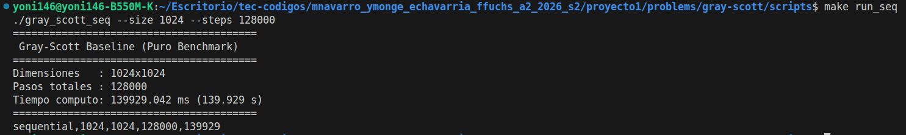

# Gray-Scott — Guía de Evaluación (Avance 2 / Demostración 2)
**CE 4302 — Arquitectura de Computadores II**  
**Instituto Tecnológico de Costa Rica (TEC)**  
**Semestre II - 2026**

---

## Resumen de Navegación para Demostración 2

Esta guía orienta al profesor y evaluadores para localizar de forma inmediata cada uno de los requerimientos solicitados para la **Demostración 2 (Semana 8)**:

| # | Requerimiento de la Evaluación | Ubicación en el Repositorio | Descripción Breve |
|---|---|---|---|
| **1** | **Identificación en código** de variables y puntos de paralelización | [`src/gray_scott_core.cpp`](src/gray_scott_core.cpp) y [`sequential/main.cpp`](sequential/main.cpp) | Comentarios inline marcando variables críticas, bucles espaciales paralelizables, cuello de botella temporal y doble búfer. |
| **2** | **Diagrama Arquitectónico Preliminar** (Secuencial vs. Paralelo) | [`docs/images/diagrama_simulacion-paralelo-secuencial_gray-scott.png`](docs/images/diagrama_simulacion-paralelo-secuencial_gray-scott.png) | Esquema visual del cambio arquitectónico: desacoplamiento en franjas contiguas (1D) y sincronización con barreras globales. |
| **3** | **2 Propuestas de Diseño comparadas por criterios** | [`docs/Propuestas.md`](docs/Propuestas.md) | Descomposición 1D (Filas) vs. 2D (Mosaicos / Tiles) evaluadas bajo Localidad de Caché L1/L2, False Sharing y Barreras. |

---

## 1. Identificación de Variables y Puntos de Paralelización en Código

Los puntos clave fueron documentados de forma directa en el código fuente:

### A. Variables Críticas del Problema
Ubicadas en [`include/gray_scott_core.hpp`](include/gray_scott_core.hpp) y [`sequential/main.cpp`](sequential/main.cpp):
* **`width` y `height`:** Determinan el espacio discreto total de datos independientes en memoria ($N = W \times H$).
* **`total_steps`:** Determina la longitud de la cadena de dependencias temporales estrictas ($t \to t+1$).
* **`Du`, `Dv`, `F`, `K`, `dt`:** Parámetros físicos que dictan la difusión y tasas cinéticas de reacción.

### B. Puntos de Paralelización (Bucles) y Cuello de Botella
Ubicados en [`src/gray_scott_core.cpp`](src/gray_scott_core.cpp) y [`sequential/main.cpp`](sequential/main.cpp):
* **Punto 1 (Bucle `y` - Franjas de Filas):** Descomposición 1D ideal para CMP y SMT, preservando la localidad contigua en memoria (*Row-Major*).
* **Punto 2 (Bucle `x` - Columnas):** Permite descomposición en bloques o mosaicos 2D para arquitecturas de grano fino (*Fine-Grained*).
* **Resolución de Data Races:** Implementación estricta de *Double Buffering* (`current` y `next`), permitiendo lecturas concurrentes sin necesidad de cerrojos (*locks*).
* **Cuello de Botella Identificado:** La dependencia temporal estricta ($t \to t+1$) exige una barrera de sincronización por paso (`std::barrier`) antes de alternar buffers (`std::swap`).

---

## 2. Diagrama Arquitectónico Preliminar (Secuencial vs. Paralelo)

El siguiente esquema compara el flujo del baseline secuencial con la arquitectura paralelizable basada en descomposición de dominio 1D:


### Justificación Arquitectónica:
1. **Descomposición 1D por Filas ($H/N$):** La matriz se divide horizontalmente en franjas continuas asignadas a hilos persistentes, maximizando los aciertos en las líneas de caché L1/L2 (64 bytes) al recorrer la memoria de forma lineal (*Row-Major*).
2. **Double Buffering:** Evita condiciones de carrera entre hilos adyacentes al leer únicamente de `current` y escribir exclusivamente en `next`.
3. **Barrera de Sincronización:** Asegura que ningún núcleo inicie el cómputo del paso $(t + 1)$ hasta que todos los hilos hayan concluido sus respectivas franjas del paso $(t)$.

---

## 3. Requisitos, Compilación y Ejecución del Sistema Base

El proyecto está implementado en **C++17** con optimizaciones de compilador `-O3`, temporización de alta precisión mediante `std::chrono` y generación de video automatizada con `ffmpeg`.

### Requisitos en Linux:
```bash
sudo apt update
sudo apt install -y g++ make ffmpeg fonts-dejavu-core
```

### Compilación:
Desde la carpeta de scripts:
```bash
cd scripts/
make
```

---

### Modo 1: Benchmark Puro (Sin Video)
Diseñado para la toma rigurosa de métricas de hardware y tiempos de CPU sin interferencia de operaciones de I/O en disco:

```bash
make run_seq
```

#### Salida de Terminal Obtenida:


> **Nota de Rendimiento:** En una prueba de esfuerzo a alta resolución ($1024 \times 1024$ celdas) y $128{,}000$ pasos temporales, el cómputo puro del procesador tomó **139.929 segundos**, procesando más de 134 mil millones de evaluaciones de stencil sin overhead de disco.

---

### Modo 2: Generación de Video Sincronizado
Compila la simulación, exporta los fotogramas PPM temporales e invoca `ffmpeg` con un filtro que calcula dinámicamente el tiempo de CPU por fotograma:

```bash
make run_seq_video
```

*El video final se almacena en `videos/gray-scott-secuencial.mp4`.*

#### Progresión Morfológica de la Simulación ($1024 \times 1024$):

| Estado Inicial (Paso 6,000) | Estado Intermedio (Paso 58,500) | Estado Maduro (Paso 128,000) |
|:---:|:---:|:---:|
|  |  |  |
| **Tiempo CPU: 6.58 s** | **Tiempo CPU: 64.23 s** | **Tiempo CPU: 140.55 s** |
| Formación de la corona bacteriana inicial concéntrica. | División y mitosis en colonias circulares estables. | Cobertura reticular del espacio bidimensional. |

---

## 4. Estructura de Archivos del Módulo

```text
gray-scott/
├── CMP/                        # Implementación con hilos físicos persistentes 
├── coarse-grained/             # Paralelización con bloques de granularidad gruesa
├── fine-grained/               # Paralelización con granularidad fina y balance dinámico
├── SMT/                        # Variante optimizada para núcleos lógicos hipertróficos
├── docs/                       # Documentación formal para evaluación
│   ├── Propuestas.md           # Comparativa formal de diseños de descomposición
│   └── images/                 # Diagramas de arquitectura y capturas de validación
│       ├── diagrama_simulacion-paralelo-secuencial_gray-scott.png
│       ├── frame1_secuencial.png
│       ├── frame2_secuencial.png
│       ├── frame3_secuencial.png
│       └── secuencial_no_video.png
├── include/
│   ├── gray_scott_core.hpp     # Parámetros físicos, estructuras e interfaces del stencil
│   └── grid.hpp                # Contenedor plano contiguo 1D para la malla 2D
├── scripts/
│   ├── gray_scott_seq          # Binario compilado con -O3
│   └── Makefile                # Automatización de benchmarks y pipeline de video
├── sequential/
│   └── main.cpp                # Punto de entrada del baseline y medición de tiempo
├── src/
│   └── gray_scott_core.cpp     # Núcleo de reacción-difusión FTCS y exportación PPM
├── videos/                     # Carpeta de salida de video (.gitignore)
├── .gitkeep
└── README.md                   # Esta guía de evaluación
```