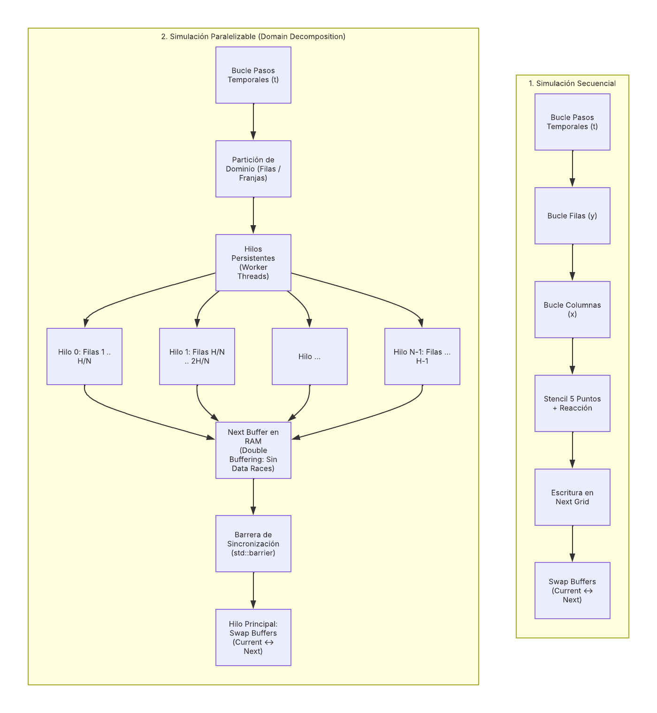
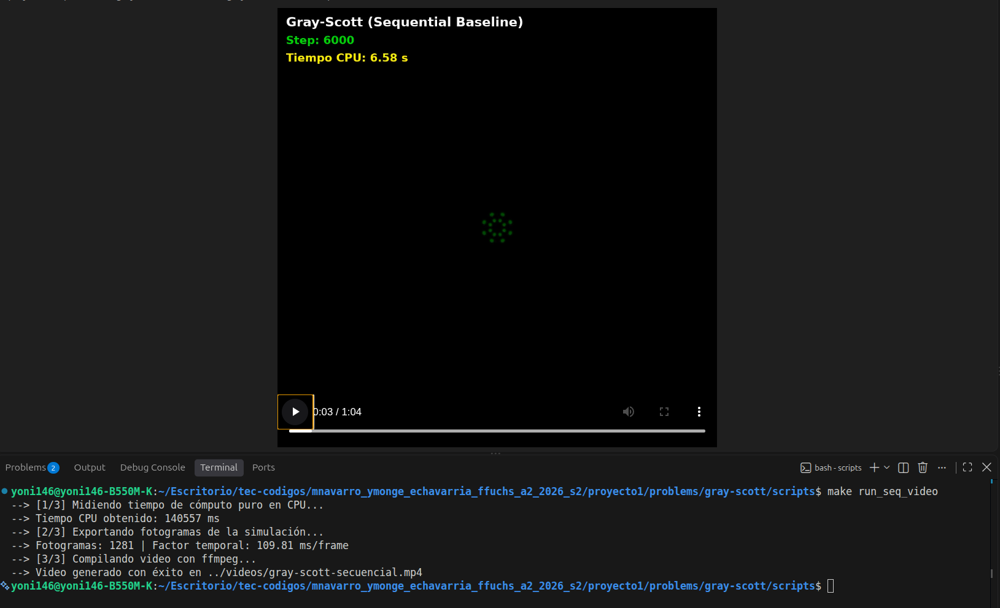
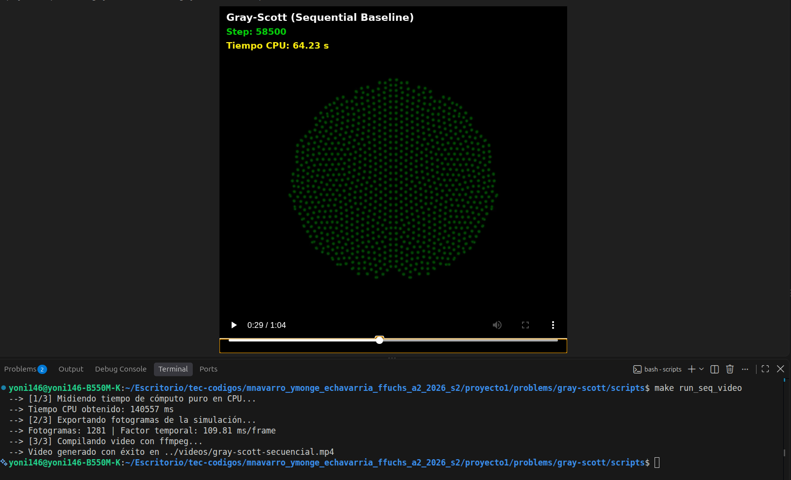
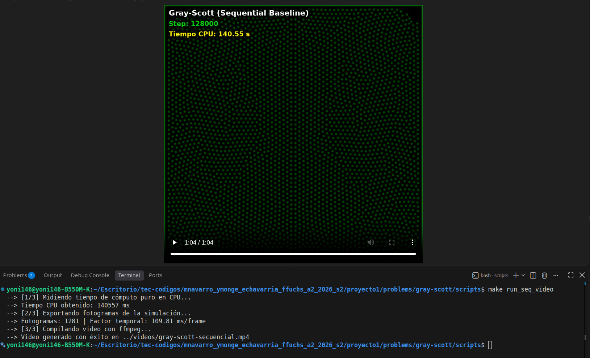

# Gray-Scott — Guía 
**CE 4302 — Arquitectura de Computadores II**  
**Instituto Tecnológico de Costa Rica (TEC)**  
**Semestre II - 2026**

---

## Resumen de Navegación para Demostración 2

Esta guía orienta al profesor y evaluadores para localizar de forma inmediata cada uno de los requerimientos solicitados para la **Demostración 2 (Semana 8)**:

| # | Requerimiento de la Evaluación | Ubicación en el Repositorio | Descripción Breve |
|---|---|---|---|
| **1** | **Identificación en código** de variables y puntos de paralelización | [`src/gray_scott_core.cpp`](src/gray_scott_core.cpp) y [`sequential/main.cpp`](sequential/main.cpp) | Comentarios inline marcando variables críticas, bucles espaciales paralelizables, cuello de botella temporal y doble búfer. |
| **2** | **Diagrama Arquitectónico Preliminar** (Secuencial vs. Paralelo) | [`docs/images/diagrama_simulacion-paralelo-secuencial_gray-scott.png`](docs/images/diagrama_simulacion-paralelo-secuencial_gray-scott.png) | Esquema visual del cambio arquitectónico: desacoplamiento en franjas contiguas (1D) y sincronización con barreras globales. |
| **3** | **2 Propuestas de Diseño comparadas por criterios** | [`docs/Propuestas.md`](docs/Propuestas.md) | Descomposición 1D (Filas) vs. 2D (Mosaicos / Tiles) evaluadas bajo Localidad de Caché L1/L2, False Sharing y Barreras. |

---

## 1. Identificación de Variables y Puntos de Paralelización en Código

Los puntos clave fueron documentados de forma directa en el código fuente:

### A. Variables Críticas del Problema
Ubicadas en [`include/gray_scott_core.hpp`](include/gray_scott_core.hpp) y [`sequential/main.cpp`](sequential/main.cpp):
* **`width` y `height`:** Determinan el espacio discreto total de datos independientes en memoria ($N = W \times H$).
* **`total_steps`:** Determina la longitud de la cadena de dependencias temporales estrictas ($t \to t+1$).
* **`Du`, `Dv`, `F`, `K`, `dt`:** Parámetros físicos que dictan la difusión y tasas cinéticas de reacción.

### B. Puntos de Paralelización (Bucles) y Cuello de Botella
Ubicados en [`src/gray_scott_core.cpp`](src/gray_scott_core.cpp) y [`sequential/main.cpp`](sequential/main.cpp):
* **Punto 1 (Bucle `y` - Franjas de Filas):** Descomposición 1D ideal para CMP y SMT, preservando la localidad contigua en memoria (*Row-Major*).
* **Punto 2 (Bucle `x` - Columnas):** Permite descomposición en bloques o mosaicos 2D para arquitecturas de grano fino (*Fine-Grained*).
* **Resolución de Data Races:** Implementación estricta de *Double Buffering* (`current` y `next`), permitiendo lecturas concurrentes sin necesidad de cerrojos (*locks*).
* **Cuello de Botella Identificado:** La dependencia temporal estricta ($t \to t+1$) exige una barrera de sincronización por paso (`std::barrier`) antes de alternar buffers (`std::swap`).

---

## 2. Diagrama Arquitectónico Preliminar (Secuencial vs. Paralelo)

El siguiente esquema compara el flujo del baseline secuencial con la arquitectura paralelizable basada en descomposición de dominio 1D:



### Justificación Arquitectónica:
1. **Descomposición 1D por Filas ($H/N$):** La matriz se divide horizontalmente en franjas continuas asignadas a hilos persistentes, maximizando los aciertos en las líneas de caché L1/L2 (64 bytes) al recorrer la memoria de forma lineal (*Row-Major*).
2. **Double Buffering:** Evita condiciones de carrera entre hilos adyacentes al leer únicamente de `current` y escribir exclusivamente en `next`.
3. **Barrera de Sincronización:** Asegura que ningún núcleo inicie el cómputo del paso $(t + 1)$ hasta que todos los hilos hayan concluido sus respectivas franjas del paso $(t)$.

---

## 3. Requisitos, Compilación y Ejecución del Sistema Base

El proyecto está implementado en **C++17** con optimizaciones de compilador `-O3`, temporización de alta precisión mediante `std::chrono` y generación de video automatizada con `ffmpeg`.

### Requisitos en Linux:
```bash
sudo apt update
sudo apt install -y g++ make ffmpeg fonts-dejavu-core python3 python3-pip python3-venv python3.14-venv
```

### Configuración del Entorno de Python:
Para la campaña de benchmarking automatizado, análisis estadístico y generación de gráficos, se cuenta con un archivo global de dependencias en `proyecto1/requirements.txt`.

**Opción A (Recomendada con entorno virtual):**
```bash
# Desde la raíz de proyecto1/:
cd /ruta/hacia/proyecto1
python3 -m venv venv
source venv/bin/activate
pip install -r requirements.txt
```

**Opción B (Instalación directa):**
```bash
# Desde esta carpeta (gray-scott/):
pip install -r ../../requirements.txt
```

> **Nota:** El script de medición `scripts/benchmark.py` utiliza exclusivamente la biblioteca estándar de Python para registrar las corridas y escribir los `.csv`, por lo que funcionará de forma nativa incluso sin instalar paquetes adicionales. Las dependencias externas (`pandas`, `matplotlib`, `seaborn`) son utilizadas para el análisis avanzado y la generación de gráficos en la carpeta `metricas/`.

---

### 3.1 Compilación de los Ejecutables
Todas las reglas de compilación se ejecutan desde el directorio `scripts/` utilizando `g++` con estándar **C++17**, flags de máxima optimización arquitectónica (`-O3`), advertencias estrictas (`-Wall -Wextra`), inclusión de encabezados (`-I../include`) y soporte multihilo (`-pthread`):

```bash
cd scripts/

# Compilar todos los modelos simultáneamente (5 binarios):
make
# o equivalentemente:
make all

# Compilación individual de binarios específicos:
make sequential  # Genera: gray_scott_sequential
make cmp         # Genera: gray_scott_cmp
make smt         # Genera: gray_scott_smt
make coarse      # Genera: gray_scott_coarse
make fine        # Genera: gray_scott_fine

# Limpieza de binarios compilados y carpetas temporales de video:
make clean
```

---

### 3.2 Ejecución de los 4 Modelos y sus Variantes Arquitectónicas (7 en Total)
El proyecto implementa los 4 modelos de cómputo multihilo requeridos en la especificación, los cuales se desglosan experimentalmente en **7 variantes de ejecución microarquitectónica**:

1. **Secuencial (Baseline):**
   * **Comando:** `make run_sequential`  
     *(Equivalente directo: `./gray_scott_seq --size 512 --steps 16000`)*
   * **Descripción:** Ejecución de referencia en un único hilo y un solo núcleo de CPU. Opera como la línea base matemática ($S = 1.0\text{x}$) sin costes de sincronización ni contención.

2. **CMP (Chip Multiprocessing):**
   * **Comando:** `make run_cmp`  
     *(Equivalente directo: `./gray_scott_cmp --threads 8 --size 512 --steps 16000`)*
   * **Descripción:** Paralelismo multinúcleo puro utilizando 8 hilos físicos persistentes (1 hilo dedicado por núcleo físico) con barreras de sincronización reutilizables al cierre de cada paso temporal.

3. **SMT en Hardware Real (SMT ON):**
   * **Comando:** `make run_smt`  
     *(Equivalente directo: `./gray_scott_smt --threads 16 --size 512 --steps 16000`)*
   * **Descripción:** Ejecución de 16 hilos compitiendo dinámicamente en el pipeline de hardware de los 8 núcleos físicos con Simultaneous Multithreading activo en el procesador.

4. **SMT con Sobre-suscripción por Software (SMT OFF):**
   * **Comando:** `make run_smt_sw`  
     *(Requiere privilegios `sudo` para alternar temporalmente `/sys/devices/system/cpu/smt/control`)*
   * **Descripción:** Ejecuta 16 hilos lógicos pero desactivando SMT en el kernel Linux para forzar al planificador del sistema operativo a realizar *time-slicing* sobre 8 núcleos físicos, evidenciando el costo del cambio de contexto por software.

5. **Coarse-Grained Multithreading (Grano Grueso):**
   * **Comando:** `make run_coarse`  
     *(Equivalente directo: `./gray_scott_coarse --threads 8 --size 512 --steps 16000`)*
   * **Descripción:** Descomposición del dominio espacial en ráfagas largas de bloques contiguos (chunks de 64 filas por hilo) maximizando la localidad espacial de caché y sincronizándose por barrera al término de cada iteración.

6. **Fine-Grained Cooperativo (Emulación Software por Corutinas):**
   * **Comando:** `make run_fine`  
     *(Equivalente directo: `./gray_scott_fine --threads 8 --quantum 1 --mode cooperative --size 512 --steps 16000`)*
   * **Descripción:** Simulación de grano fino en espacio de usuario mediante corutinas en un único hilo físico de CPU con quantum estricto de 1 fila ($Q=1$), alternando incondicionalmente en round-robin entre 8 tareas lógicas.

7. **Fine-Grained Paralelo Cíclico (Hardware Multihilo):**
   * **Comando:** `make run_fine_parallel`  
     *(Equivalente directo: `./gray_scott_fine --threads 8 --quantum 1 --mode parallel --size 512 --steps 16000`)*
   * **Descripción:** Ejecución de grano fino distribuida en 8 hilos de hardware reales donde las filas se asignan de forma cíclica intercalada (hilo $i$ procesa las filas $i, i+8, \dots$), permitiendo estudiar la degradación de localidad de caché y contención en la interconexión.

---

### 3.3 Verificación Numérica y Corrección Cruzada
Para garantizar la validez científica y matemática de todas las optimizaciones concurrentes, cada modelo incluye una rutina de validación que compara celda a celda los arreglos finales contra la solución secuencial exacta con tolerancia de punto flotante $\epsilon = 10^{-5}$:

```bash
# Validar modelo CMP frente a Secuencial:
make verify_cmp

# Validar modelo SMT frente a Secuencial:
make verify_smt

# Validar modelo Coarse-Grained frente a Secuencial:
make verify_coarse

# Validar modelo Fine-Grained frente a Secuencial:
make verify_fine
```
* **Uso directo:** Todos los binarios aceptan el flag `--verify` para realizar la comprobación in-situ con tamaños arbitrarios (ejemplo: `./gray_scott_cmp --threads 8 --size 256 --steps 1000 --verify`).

---

### 3.4 Benchmarking Automatizado Masivo (Generación de CSV)
El script maestro `scripts/benchmark.py` automatiza la recolección masiva de métricas experimentales sin intervención manual, aplicando temporización precisa en milisegundos (`std::chrono`) y exportando los datos a `metricas/`:

```bash
# Campaña formal completa (200 corridas estadísticas por cada uno de los 7 modelos = 1,400 ejecuciones):
# Sobrescribe limpiamente los archivos oficiales para garantizar integridad estadística:
make benchmark

# Prueba rápida de validación de pipeline (5 corridas por modelo):
make benchmark_fast

# Opciones avanzadas invocando directamente el script:
python3 benchmark.py --runs 200 --size 512 --steps 16000 --models all

# Anexar corridas a un CSV existente en lugar de iniciar limpio:
python3 benchmark.py --runs 10 --models "cmp" --append
```

* **Archivos generados:**
  * `metricas/gray_scott_benchmark.csv`: Muestras crudas oficiales de tiempo y configuración para las corridas estadísticas.
  * `metricas/resumen_estadistico.csv`: Consolidado estadístico oficial con Media ($\mu$), Margen de Error ($\pm \text{ME}$ al 95%), Intervalo de Confianza al 95% ($[\text{IC}_{\text{inf}}, \text{IC}_{\text{sup}}]$), Desviación Estándar ($\sigma$), Mediana, Speedup ($S$) y Eficiencia ($E$).

#### Tabla Consolidada de Benchmarking Oficial ($N = 200$ corridas por modelo, AMD Ryzen 7 7730U):

| Modelo | Modo | Hilos | Media $\mu$ (ms) | Margen Error $\pm \text{ME}$ (95%) | Intervalo Confianza 95% (ms) | Speedup $S$ | Eficiencia $E$ |
| :--- | :--- | :---: | :---: | :---: | :---: | :---: | :---: |
| **CMP** | `dedicated_cores` | 8 | **1061.94** | $\pm 6.69$ | **[1055.25, 1068.63]** | **4.09x** | **51.1%** |
| **SMT (HW Real)** | `hardware_smt` | 16 | **1102.88** | $\pm 18.03$ | **[1084.85, 1120.91]** | **3.94x** | 24.6% |
| **Coarse-Grained** | `burst_block` | 8 | **1269.43** | $\pm 8.07$ | **[1261.36, 1277.50]** | **3.42x** | 42.8% |
| **SMT (Sobre-suscripción SW)** | `software_oversubscription` | 16 | **1443.01** | $\pm 42.97$ | **[1400.04, 1485.99]** | **3.01x** | 18.8% |
| **Fine-Grained (Paralelo Cíclico)** | `cyclic_threads` | 8 | **1565.56** | $\pm 10.63$ | **[1554.93, 1576.18]** | **2.77x** | 34.7% |
| **Secuencial (Baseline)** | `baseline` | 1 | **4344.25** | $\pm 14.41$ | **[4329.84, 4358.66]** | **1.00x** | 100.0% |
| **Fine-Grained (Cooperativo)** | `cooperative_quantum` | 8 | **4482.44** | $\pm 16.81$ | **[4465.63, 4499.26]** | **0.97x** | 12.1% |

---

### 3.5 Generación de Gráficas de Rendimiento (Visualización Científica en 300 DPI)
El conjunto de herramientas de visualización genera estrictamente el estándar unificado de **8 figuras científicas** con calidad de publicación (300 DPI):

```bash
# Generar el set completo de las 8 figuras (usa automáticamente el entorno virtual venv):
make plot_all

# o para actualizar las figuras de benchmarking y escalabilidad:
make graficas
```

* **Visualizaciones exportadas en `metricas/graficas/`:**
  1. **`01_tiempos_ejecucion_boxplot.png`**: Distribución de tiempos y diagramas de caja (Tukey boxplots) de las 200 corridas por modelo con medianas y medias indicadas.
  2. **`02_speedup_comparativo.png`**: Aceleración relativa ($S = T_{\text{sec}}/T_{\text{par}}$) con barras de error de Intervalos de Confianza al 95% ($\text{IC}_{95}$) y línea base secuencial (1.0x).
  3. **`03_eficiencia_paralela.png`**: Eficiencia porcentual ($E = \frac{S_p}{p} \times 100$\%) con línea ideal (100%) y umbral típico (50%).
  4. **`04_escalabilidad_hilos.png`**: Curvas de escalabilidad fuerte ($p \in \{1, 2, 4, 8, 16\}$ hilos) contrastadas con aceleración lineal ideal ($S(p) = p$) y curvas teóricas de la Ley de Amdahl (90%, 95%, 98%), con etiquetas anti-colisión en $p=16$.
  5. **`05_perf_ipc_comparativo.png`**: Instrucciones retiradas por ciclo de reloj (IPC) de hardware medido con `perf stat` (promedio de 3 corridas).
  6. **`06_perf_cache_miss_rates.png`**: Análisis de la jerarquía de memoria en dos paneles: Tasa de fallos en L1 Data Cache (%) y en Last-Level Cache (L3/LLC %).
  7. **`07_perf_context_switches.png`**: Sobrecarga de cambios de contexto del sistema operativo (`context-switches`) por modelo.
  8. **`08_dashboard_consolidado.png`**: Tablero general multipanel (2x2) que consolida: (A) Tiempos medios con IC 95%, (B) Speedup relativo, (C) Eficiencia paralela, (D) Coeficiente de variación ($CV = \sigma/\mu$, jitter e inestabilidad).

---

### 3.6 Generación de Videos Sincronizados con el Tiempo Real de CPU
Compila el modelo seleccionado, ejecuta la simulación exportando fotogramas PPM temporales e invoca `ffmpeg` para compilar un video `.mp4` de alta resolución ($512 \times 512$ a 20 FPS). Un filtro dinámico proyecta en pantalla el tiempo de CPU acumulado y el número de paso de la reacción química:

```bash
# Video para modelo Secuencial:
make run_seq_video        # Genera: videos/gray-scott-secuencial.mp4

# Video para modelo CMP (8 núcleos físicos):
make run_cmp_video        # Genera: videos/gray-scott-cmp.mp4

# Video para modelo SMT (16 hilos lógicos):
make run_smt_video        # Genera: videos/gray-scott-smt.mp4

# Video para modelo Coarse-Grained (ráfagas de bloques):
make run_coarse_video     # Genera: videos/gray-scott-coarse.mp4

# Video para modelo Fine-Grained (conmutación fina):
make run_fine_video       # Genera: videos/gray-scott-fine.mp4
```

#### Progresión Morfológica de la Simulación ($1024 \times 1024$):

| Estado Inicial (Paso 6,000) | Estado Intermedio (Paso 58,500) | Estado Maduro (Paso 128,000) |
|:---:|:---:|:---:|
|  |  |  |
| **Tiempo CPU: 6.58 s** | **Tiempo CPU: 64.23 s** | **Tiempo CPU: 140.55 s** |
| Formación de la corona bacteriana inicial concéntrica. | División y mitosis en colonias circulares estables. | Cobertura reticular del espacio bidimensional. |

---

### 3.7 Perfilado Microarquitectónico de Hardware con Linux `perf`
Permite analizar de forma explícita el comportamiento del pipeline, la contención en el subsistema de memoria y la concurrencia bajo SMT y los distintos modelos mediante contadores de rendimiento de hardware (PMU):

```bash
# Habilitar contadores PMU sin requerir root en cada comando:
make setup_perf

# Ejecución completa de perfilado (3 corridas por modelo para promedio):
make profile_perf

# Prueba rápida de perfilado (1 corrida por modelo):
make profile_fast

# Regenerar figuras 05, 06 y 07 directamente desde CSV sin invocar perf:
make profile_plot
```

* **Archivos generados:**
  * `metricas/gray_scott_perf_metrics.csv`: Tabla cuantitativa con métricas de hardware extraídas por modelo (promedio de 3 corridas).
  * `metricas/graficas/05_perf_ipc_comparativo.png`: Instrucciones retiradas por ciclo (IPC).
  * `metricas/graficas/06_perf_cache_miss_rates.png`: Tasas de fallos en L1-D y LLC/L3 en doble panel.
  * `metricas/graficas/07_perf_context_switches.png`: Cambios de contexto del sistema operativo.

---

### 3.8 Estudio de Escalabilidad Fuerte (Strong Scaling) y Validación Rápida
Evalúa la escalabilidad realizando un barrido sistemático del número de hilos de ejecución ($p \in \{1, 2, 4, 8, 16\}$) sobre una grilla constante de $512 \times 512$ y $16{,}000$ pasos temporales:

```bash
# Campaña formal completa de escalabilidad (200 corridas por hilo = 1,000 corridas en total):
make scalability

# Prueba rápida de escalabilidad (3 corridas por hilo):
make scalability_fast

# Solo graficar figura 04 desde el CSV existente:
make scalability_plot

# Smoke test completo rápido (valida las 8 figuras de punta a punta con pocas corridas):
make campaign_smoke

# Campaña experimental completa de 200 corridas (200 corridas modelo + 1,000 corridas escalabilidad + perfilado):
make campaign_200
```

* **Modelos evaluados:** CMP, SMT (HW Real), Coarse-Grained y Fine-Grained (Paralelo Cíclico).
* **Contraste teórico:** Aceleración Lineal Ideal ($S = p$) y Ley de Amdahl ($S(p) = \frac{1}{(1-f) + f/p}$) con fracciones paralelizable estimadas (90%, 95%, 98%).
* **Archivos generados:**
  * `metricas/gray_scott_strong_scaling.csv`: Resumen cuantitativo de escalabilidad (compatible con `raytracing_strong_scaling.csv`).
  * `metricas/graficas/04_escalabilidad_hilos.png`: Visualización con curvas de Amdahl y etiquetas anti-colisión en $p=16$.

---

## 4. Estructura de Archivos del Módulo

```text
proyecto1/
├── requirements.txt            # Dependencias globales de Python (numpy, pandas, matplotlib, seaborn)
└── problems/
    └── gray-scott/
        ├── CMP/                # Implementación con hilos físicos persistentes 
        ├── coarse-grained/     # Bloques continuos y bloqueo por barrera inter-paso
        ├── fine-grained/       # Planificación cooperativa por cuantums (Q=1) y cíclica
        ├── SMT/                # Variante para hilos simultáneos (HW real y sobre-suscripción SW)
        ├── docs/               # Documentación formal para evaluación
        ├── metricas/           # Salida de benchmarking y reproducibilidad experimental
        │   ├── gray_scott_benchmark.csv        # Datos crudos de las corridas estadísticas
        │   ├── resumen_estadistico.csv         # Estadísticas agregadas con IC 95% (Media, StdDev, Margen Error)
        │   ├── gray_scott_perf_metrics.csv     # Contadores PMU Linux (IPC, ciclos, fallos caché, CS)
        │   ├── gray_scott_strong_scaling.csv   # Barrido de escalabilidad fuerte (p = 1, 2, 4, 8, 16)
        │   └── graficas/                       # Visualizaciones comparativas 300 DPI (01 a 08)
        ├── include/            # Encabezados del núcleo de reacción-difusión
        ├── scripts/            # Automatización de compilación y pruebas
        │   ├── benchmark.py    # Script maestro de benchmarking estadístico (200 corridas)
        │   ├── profile_perf.py # Script de perfilado microarquitectónico con Linux perf (figuras 05, 06, 07)
        │   ├── scalability.py  # Script de barrido de escalabilidad fuerte (figura 04)
        │   ├── plot_metrics.py # Generador integral de figuras (01, 02, 03, 04, 08)
        │   └── Makefile        # Reglas para ejecución, videos, perfiles y benchmarks
        ├── sequential/         # Baseline de comparación secuencial
        ├── src/                # Implementación matemática del stencil FTCS
        ├── videos/             # Videos MP4 sincronizados con el tiempo real de CPU
        └── README.md           # Esta guía de evaluación
```
