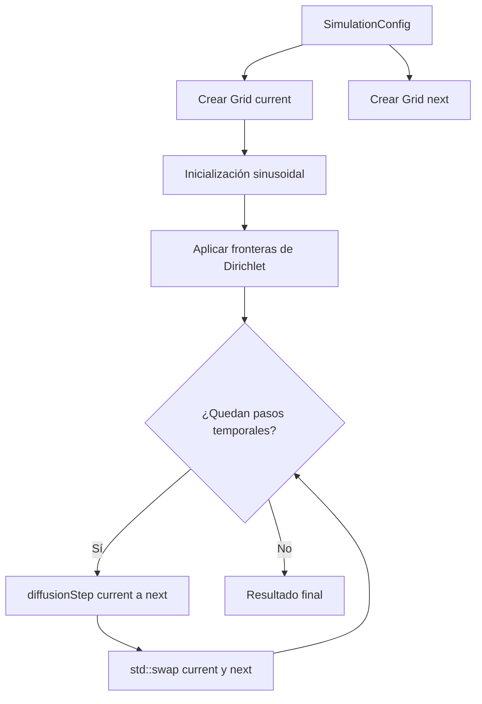
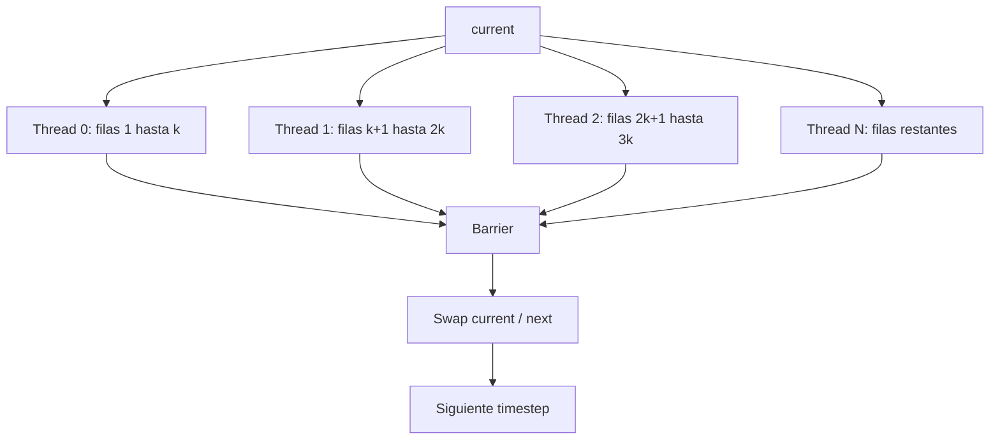

# Heat Diffusion 2D — Guía de Evaluación (Avance 2 / Demostración 2)

**CE 4302 — Arquitectura de Computadores II**  
**Instituto Tecnológico de Costa Rica (TEC)**  
**Semestre II — 2026**

---

## Resumen de Navegación para Demostración 2

Esta guía permite localizar rápidamente los elementos solicitados para la **Demostración 2 (Semana 8)** correspondientes al problema **Difusión de Calor 2D sobre una superficie**.

| # | Requerimiento de la evaluación | Ubicación en el repositorio | Descripción breve |
|---|---|---|---|
| **1** | **Ejecución del sistema base sin hilos** | [`src/main.cpp`](src/main.cpp), [`src/models/sequential.cpp`](src/models/sequential.cpp) y [`src/core/heat2d.cpp`](src/core/heat2d.cpp) | Implementación secuencial completa del método explícito de diferencias finitas para difusión de calor 2D. |
| **2** | **Identificación de variables importantes para aumentar la paralelización** | [`include/config.hpp`](include/config.hpp), [`src/core/heat2d.cpp`](src/core/heat2d.cpp) y [`src/models/sequential.cpp`](src/models/sequential.cpp) | Se identifican tamaño de malla, cantidad de pasos temporales, número de celdas interiores, granularidad del trabajo y número de hilos como variables críticas. |
| **3** | **Identificación de los puntos de paralelización** | [`src/core/heat2d.cpp`](src/core/heat2d.cpp) | Los bucles sobre las filas y columnas interiores pueden distribuirse entre múltiples trabajadores porque cada celda lee de `current` y escribe en una posición independiente de `next`. |
| **4** | **Diagramas preliminares de las soluciones** | Sección 4 | Se muestra la transición del sistema secuencial hacia una solución paralela mediante división por filas y mediante bloques 2D. |
| **5** | **Dos propuestas de diseño comparadas** | Sección 5 | Se comparan descomposición estática por filas y descomposición 2D mediante tiles según balance, caché, sincronización, granularidad y complejidad. |
| **6** | **Validación del sistema secuencial** | [`tests/stress_sequential.cpp`](tests/stress_sequential.cpp) | Prueba de estrés que verifica estabilidad, fronteras, simetría, disipación térmica y error contra la solución analítica. |

---

# 1. Descripción del Problema

El problema seleccionado consiste en simular la **difusión de calor sobre una superficie bidimensional**.

La superficie se representa mediante una malla rectangular donde cada posición almacena una temperatura $T[i][j]$.

La evolución de la temperatura está descrita por la ecuación del calor bidimensional:

```math
\frac{\partial T}{\partial t}
=
\alpha
\left(
\frac{\partial^2 T}{\partial x^2}
+
\frac{\partial^2 T}{\partial y^2}
\right)
```

donde:

- $T$ representa la temperatura.
- $\alpha$ representa la difusividad térmica.
- $x$ y $y$ representan las coordenadas espaciales.
- $t$ representa el tiempo.

Para resolver numéricamente la ecuación se utiliza un esquema explícito de **diferencias finitas**.

Para cada celda interior de la superficie:

```math
T_{i,j}^{n+1}
=
T_{i,j}^{n}
+
\alpha \Delta t
\left[
\frac{
T_{i,j+1}^{n}
-
2T_{i,j}^{n}
+
T_{i,j-1}^{n}
}{
\Delta x^2
}
+
\frac{
T_{i+1,j}^{n}
-
2T_{i,j}^{n}
+
T_{i-1,j}^{n}
}{
\Delta y^2
}
\right]
```

Cada celda interior depende exclusivamente de su temperatura actual y de sus cuatro vecinos:

```text
                    T(i-1,j)
                        ↑
                        │
T(i,j-1)  ←         T(i,j)         →  T(i,j+1)
                        │
                        ↓
                    T(i+1,j)
```

Por lo tanto, el cálculo de una celda en el instante $n+1$ utiliza únicamente información correspondiente al instante $n$.

El resultado se almacena en una segunda malla.

Esta característica permite que **todas las celdas interiores de un mismo paso temporal puedan ser calculadas de manera independiente**.

---

# 2. Sistema Base Secuencial

## 2.1 Organización del Sistema

La implementación secuencial se encuentra dividida en diferentes módulos para separar:

- representación de datos;
- configuración;
- física del problema;
- condiciones iniciales;
- modelo de ejecución.

La estructura actual es:

```text
heat2d/
├── include/
│   ├── config.hpp
│   ├── grid.hpp
│   ├── heat2d.hpp
│   ├── initial_conditions.hpp
│   └── sequential.hpp
│
├── src/
│   ├── main.cpp
│   │
│   ├── core/
│   │   ├── grid.cpp
│   │   ├── heat2d.cpp
│   │   └── initial_conditions.cpp
│   │
│   └── models/
│       └── sequential.cpp
│
└── tests/
    └── stress_sequential.cpp
```

### Responsabilidades de los Archivos

#### `grid.hpp` / `grid.cpp`

Representan la superficie bidimensional.

La matriz lógica $T[i][j]$ se almacena físicamente mediante un único `std::vector<double>` contiguo.

La transformación de una coordenada bidimensional hacia memoria lineal es:

```math
index(i,j)
=
i \cdot N_{columnas}
+
j
```

Esta representación favorece:

- localidad espacial;
- accesos consecutivos a memoria;
- aprovechamiento de líneas de caché;
- división posterior de regiones entre hilos.

---

#### `initial_conditions.hpp` / `initial_conditions.cpp`

Inicializan la distribución térmica del sistema.

La condición inicial utilizada es:

```math
T(x,y,0)
=
T_{\max}
\sin
\left(
\frac{\pi x}{L_x}
\right)
\sin
\left(
\frac{\pi y}{L_y}
\right)
```

Para una superficie de $1\,m \times 1\,m$ y una temperatura máxima de $100^\circ C$:

```math
T(0.5,0.5,0)
=
100^\circ C
```

También se implementan condiciones de frontera de **Dirichlet**, manteniendo los cuatro bordes a una temperatura fija.

Actualmente:

```math
T_{borde}
=
0^\circ C
```

---

#### `heat2d.hpp` / `heat2d.cpp`

Contienen el núcleo matemático de la simulación.

La función principal es:

```cpp
diffusionStep(...)
```

Su responsabilidad es transformar:

```text
current
   ↓
ecuación de difusión
   ↓
next
```

Es decir:

```math
T^n
\longrightarrow
T^{n+1}
```

También contiene la verificación de estabilidad numérica.

---

#### `sequential.hpp` / `sequential.cpp`

Implementan el modelo de ejecución secuencial.

El flujo general es:

```text
diffusionStep()
      ↓
std::swap(current, next)
      ↓
siguiente paso temporal
```

Este procedimiento se repite durante todos los pasos temporales solicitados.

---

#### `config.hpp`

Contiene los principales parámetros físicos y numéricos:

- `rows`
- `cols`
- `lengthX`
- `lengthY`
- `alpha`
- `dt`
- `totalTime`
- `maxTemperature`
- `boundaryTemperature`

También calcula:

```math
\Delta x
=
\frac{L_x}{N_x-1}
```

```math
\Delta y
=
\frac{L_y}{N_y-1}
```

y la cantidad de pasos temporales:

```math
N_{steps}
\approx
\frac{t_{total}}{\Delta t}
```

---

#### `main.cpp`

Es el punto de entrada del sistema secuencial.

Se encarga de:

1. crear la configuración;
2. crear las dos mallas;
3. aplicar la condición inicial;
4. verificar estabilidad;
5. ejecutar la simulación secuencial;
6. mostrar los resultados finales.

---

#### `stress_sequential.cpp`

Contiene las pruebas robustas utilizadas para verificar que la implementación secuencial produce resultados numéricamente correctos.

---

## 2.2 Flujo de Ejecución Secuencial



El sistema utiliza **double buffering**:

```text
Paso n:

current ── lectura ──► diffusionStep() ── escritura ──► next

                                                     │
                                                     ▼
                                                std::swap()

Paso n+1:

current ◄──────────────────────────────────────────── next
```

Este mecanismo evita modificar valores de temperatura que todavía son necesarios dentro del mismo paso temporal.

También evita realizar una copia completa de la matriz después de cada iteración.

---

# 3. Identificación de Variables y Puntos de Paralelización

## 3.1 Variables Críticas del Problema

### `rows` y `cols`

Determinan la resolución de la superficie.

La cantidad de celdas interiores calculadas en cada paso temporal es:

```math
N_{interior}
=
(rows-2)(cols-2)
```

Por ejemplo:

```text
101 × 101
→ 9 801 celdas interiores

801 × 801
→ 638 401 celdas interiores

2001 × 2001
→ 3 996 001 celdas interiores
```

Por lo tanto:

> **`rows` y `cols` son las variables principales que aumentan la cantidad de paralelismo espacial disponible.**

Mientras mayor sea la malla, mayor será la cantidad de operaciones independientes que pueden repartirse entre hilos.

---

### `steps`

Representa la cantidad de iteraciones temporales de la simulación:

```math
steps
\approx
\frac{totalTime}{dt}
```

La cantidad total aproximada de actualizaciones de celda es:

```math
W
=
(rows-2)(cols-2)(steps)
```

donde $W$ representa aproximadamente el trabajo computacional total.

Por ejemplo, para una malla de $801 \times 801$ y $1000$ pasos:

```math
W
=
799
\cdot
799
\cdot
1000
```

```math
W
=
638\,401\,000
```

Por lo tanto, se realizan aproximadamente:

```math
\boxed{
638.4\text{ millones de actualizaciones}
}
```

Los pasos temporales **no pueden paralelizarse directamente entre sí**, porque:

```math
T^{n+1}
\text{ depende de }
T^n
```

Sin embargo, las celdas pertenecientes al mismo paso temporal sí pueden calcularse de manera concurrente.

---

### `threadCount`

En las versiones paralelas representará la cantidad de trabajadores disponibles para dividir el dominio.

Se evaluarán configuraciones como:

```text
1 hilo
2 hilos
4 hilos
8 hilos
...
```

dependiendo de la cantidad de núcleos físicos e hilos lógicos disponibles en el hardware utilizado para los experimentos.

Esta variable permitirá estudiar:

- escalabilidad;
- speedup;
- eficiencia;
- saturación del procesador.

---

### `chunkSize` / `tileSize`

Determinará la cantidad de trabajo asignada a cada unidad de ejecución.

Los bloques grandes implican:

- menor overhead;
- menos decisiones del scheduler;
- granularidad gruesa.

Los bloques pequeños implican:

- mayor cantidad de unidades de trabajo;
- mayor frecuencia de planificación;
- granularidad fina.

> El tamaño del bloque permitirá controlar experimentalmente la granularidad de la ejecución.

---

### `alpha`, `dt`, `dx` y `dy`

Estas variables no aumentan directamente el paralelismo, pero modifican la cantidad de trabajo necesaria para representar correctamente el fenómeno físico.

La estabilidad numérica requiere:

```math
\alpha \Delta t
\left(
\frac{1}{\Delta x^2}
+
\frac{1}{\Delta y^2}
\right)
\leq
\frac{1}{2}
```

Si:

```math
\Delta x
=
\Delta y
=
h
```

entonces:

```math
\frac{\alpha\Delta t}{h^2}
\leq
\frac{1}{4}
```

Al aumentar la resolución espacial:

```math
\Delta x \downarrow
```

y:

```math
\Delta y \downarrow
```

por lo que normalmente debe disminuir también:

```math
\Delta t \downarrow
```

Esto puede provocar un aumento en la cantidad de pasos temporales y, por consecuencia, aumentar considerablemente el trabajo computacional.

---

## 3.2 Punto Principal de Paralelización

El principal punto de paralelización se encuentra dentro de:

[`src/core/heat2d.cpp`](src/core/heat2d.cpp)

en la función:

```cpp
diffusionStep(...)
```

Actualmente la ejecución es:

```cpp
for (std::size_t row = 1; row < current.rows() - 1; ++row) {

    for (std::size_t col = 1; col < current.cols() - 1; ++col) {

        // Leer vecinos desde current.
        // Calcular nueva temperatura.
        // Escribir únicamente en next(row, col).
    }
}
```

Durante un mismo paso temporal:

```text
Celda (1,1) ─┐
Celda (1,2) ─┤
Celda (1,3) ─┤
Celda (2,1) ─┼──► pueden calcularse independientemente
Celda (2,2) ─┤
Celda (2,3) ─┤
...          ─┘
```

Esto es posible porque cada trabajador:

1. lee únicamente de `current`;
2. escribe únicamente en posiciones independientes de `next`;
3. no necesita utilizar resultados parciales de otro trabajador durante el mismo timestep.

Por lo tanto, dentro de cada paso temporal se puede aplicar paralelismo espacial.

---

## 3.3 Punto de Sincronización

Aunque las celdas de una iteración son independientes, el siguiente paso temporal no puede comenzar hasta que todas hayan sido calculadas.

Por lo tanto, será necesaria una sincronización global:

```text
Thread 0 ──────────┐
Thread 1 ──────────┤
Thread 2 ──────────┼──► BARRIER ──► SWAP ──► timestep siguiente
Thread 3 ──────────┘
```

Matemáticamente, $T^{n+1}$ debe estar completamente calculado antes de utilizarlo para obtener $T^{n+2}$.

---

# 4. Diagramas Preliminares de Solución

## 4.1 Arquitectura Secuencial Actual


Actualmente un único flujo de ejecución procesa secuencialmente todas las filas y columnas de la superficie.

---

## 4.2 Arquitectura Paralela Preliminar — División por Filas



El cambio principal sería:

```text
SECUENCIAL

Un trabajador
      │
      ▼
Todas las filas
```

frente a:

```text
PARALELO

                 ┌── Thread 0 → filas A
                 │
Grid ────────────┼── Thread 1 → filas B
                 │
                 ├── Thread 2 → filas C
                 │
                 └── Thread 3 → filas D
```

Esta estrategia aprovecha que las filas consecutivas también ocupan regiones consecutivas de memoria.

---

## 4.3 Arquitectura Paralela Preliminar — División mediante Tiles

La superficie también puede dividirse en pequeños bloques bidimensionales:

```text
┌────────────┬────────────┬────────────┐
│   Tile 0   │   Tile 1   │   Tile 2   │
├────────────┼────────────┼────────────┤
│   Tile 3   │   Tile 4   │   Tile 5   │
├────────────┼────────────┼────────────┤
│   Tile 6   │   Tile 7   │   Tile 8   │
└────────────┴────────────┴────────────┘
```

Posteriormente:

```text
                 Tiles disponibles
                        │
                        ▼
                 Scheduler / Cola
                        │
          ┌─────────────┼─────────────┐
          ▼             ▼             ▼
      Thread 0       Thread 1      Thread 2
```

El tamaño del tile podría ser configurable:

```text
8 × 8
16 × 16
32 × 32
64 × 64
```

Esto permitiría estudiar experimentalmente cómo cambia el rendimiento según la granularidad.

---

# 5. Dos Propuestas Preliminares de Diseño

## 5.1 Propuesta 1 — Descomposición Estática por Filas

La superficie se divide en franjas horizontales.

Por ejemplo, utilizando cuatro hilos:

```text
┌─────────────────────────────────┐
│             Thread 0            │
├─────────────────────────────────┤
│             Thread 1            │
├─────────────────────────────────┤
│             Thread 2            │
├─────────────────────────────────┤
│             Thread 3            │
└─────────────────────────────────┘
```

Cada hilo recibe aproximadamente:

```math
N_{filas/thread}
\approx
\frac{rows-2}{threadCount}
```

filas interiores.

### Ventajas

- Implementación sencilla.
- Bajo overhead de planificación.
- Buena localidad espacial.
- Accesos mayormente contiguos a memoria.
- Balance de carga muy predecible.
- Adecuada para **CMP**.
- Adecuada para aproximar **Coarse-Grained Multithreading**.

### Desventajas

- Granularidad relativamente grande.
- Menor flexibilidad para controlar el tamaño de las tareas.
- Cuando la cantidad de hilos crece demasiado puede haber pocas filas por trabajador.
- Es menos adecuada para simular planificación extremadamente frecuente.

---

## 5.2 Propuesta 2 — Descomposición Bidimensional mediante Tiles

La superficie se divide en pequeños bloques bidimensionales.

Por ejemplo:

```math
16 \times 16
```

celdas por bloque.

Cada bloque constituye una unidad independiente de trabajo.

### Ventajas

- Granularidad configurable.
- Permite crear una gran cantidad de unidades de trabajo.
- Facilita planificación round-robin.
- Permite implementar scheduling dinámico.
- Adecuada para aproximar **Fine-Grained Multithreading**.
- Permite estudiar el efecto del tamaño de tarea sobre caché y overhead.
- Puede utilizarse junto con sobresuscripción para pruebas relacionadas con SMT.

### Desventajas

- Mayor complejidad del scheduler.
- Mayor overhead de planificación.
- Tiles excesivamente pequeños pueden reducir el rendimiento.
- Requiere más decisiones de coordinación entre trabajadores.

---

## 5.3 Comparación de las Propuestas

| Criterio | División por Filas | División por Tiles |
|---|---:|---:|
| Complejidad de implementación | Baja | Media |
| Localidad espacial | Muy buena | Buena / Muy buena |
| Overhead de scheduling | Bajo | Mayor |
| Cantidad de tareas disponibles | Limitada por filas | Muy alta |
| Balance de carga en Heat2D | Muy bueno | Muy bueno |
| Granularidad configurable | Limitada | Alta |
| Adecuada para Coarse-Grained | **Sí** | Posible |
| Adecuada para CMP | **Sí** | Sí |
| Adecuada para Fine-Grained | Limitada | **Sí** |
| Scheduling round-robin | Poco flexible | **Muy flexible** |
| Riesgo de overhead excesivo | Bajo | Alto para tiles pequeños |

---

## 5.4 Uso Preliminar de Cada Propuesta

La distribución preliminar sería:

```text
                  Heat Diffusion 2D
                          │
             ┌────────────┴────────────┐
             │                         │
             ▼                         ▼
       División por filas         División por Tiles
             │                         │
       ┌─────┴──────┐                  │
       ▼            ▼                  ▼
Coarse-Grained     CMP           Fine-Grained
                                      │
                                      ▼
                              Scheduler Round-Robin
```

Para SMT se estudiará el comportamiento del kernel paralelo utilizando:

- múltiples hilos;
- sobresuscripción;
- hilos lógicos;
- comparación SMT habilitado y deshabilitado.

---

# 6. Cambios Más Significativos Previstos

## 6.1 Sistema Secuencial Actual

Actualmente:

```text
for cada timestep:

    for cada fila interior:

        for cada columna interior:

            leer current

            calcular nueva temperatura

            escribir next

    swap(current, next)
```

Existe un único flujo de ejecución.

---

## 6.2 Sistema Paralelo Preliminar

La estructura futura será aproximadamente:

```text
crear trabajadores

for cada timestep:

    dividir el dominio

    entregar trabajo a los trabajadores

    ejecutar regiones simultáneamente

    esperar a todos los trabajadores

    barrier

    swap(current, next)

siguiente timestep
```

Por lo tanto, el cambio principal consiste en transformar:

```text
1 flujo
   ↓
N filas
```

en:

```text
N trabajadores
      ↓
regiones independientes de la superficie
```

---

## 6.3 Separación entre Física y Modelo de Ejecución

Una decisión importante del diseño consiste en mantener separada la ecuación física del mecanismo de ejecución.

```text
                    CORE HEAT2D
                         │
                         │
                ecuación de difusión
                         │
          ┌──────────────┼───────────────┐
          │              │               │
          ▼              ▼               ▼
     Secuencial      Fine-Grained    Coarse-Grained
                                         │
                               ┌─────────┴─────────┐
                               ▼                   ▼
                              CMP                 SMT
```

La ecuación matemática debe permanecer idéntica.

> **Lo único que cambia entre experimentos es cómo se distribuye y ejecuta el trabajo computacional.**

Esto permitirá realizar comparaciones experimentales más justas.

---

# 7. Ejecución del Sistema Base sin Hilos

## 7.1 Compilación en macOS usando Clang

Desde la raíz del repositorio:

```bash
clang++ \
  -std=c++17 \
  -Wall \
  -Wextra \
  -Wpedantic \
  -Iproyecto1/problems/heat2d/include \
  proyecto1/problems/heat2d/src/main.cpp \
  proyecto1/problems/heat2d/src/core/grid.cpp \
  proyecto1/problems/heat2d/src/core/initial_conditions.cpp \
  proyecto1/problems/heat2d/src/core/heat2d.cpp \
  proyecto1/problems/heat2d/src/models/sequential.cpp \
  -o heat2d_sequential
```

---

## 7.2 Ejecución

```bash
./heat2d_sequential
```

---

## 7.3 Salida Obtenida

```text
=== Heat Diffusion 2D - Sequential Simulation ===
Surface size: 1.000000 m x 1.000000 m
Grid size: 101 x 101
dx: 0.010000 m
dy: 0.010000 m
Alpha: 0.050000
dt: 0.000100 s
Requested simulation time: 0.100000 s
Time steps: 1000
Actually simulated time: 0.100000 s
Numerical stability: STABLE
Initial center temperature: 100.000000 C
Final center temperature: 90.602100 C
Simulation completed successfully.
```

Esta versión constituye el **sistema base sin hilos**.

Su tiempo de ejecución será utilizado posteriormente como referencia para calcular las métricas de rendimiento de los modelos paralelos.

---

# 8. Validación Robusta de la Implementación Secuencial

Además del sistema base, se desarrolló:

[`tests/stress_sequential.cpp`](tests/stress_sequential.cpp)

Esta prueba ejecuta una configuración considerablemente más pesada.

## 8.1 Configuración de Stress Test

```text
Malla:               801 × 801
Longitud X:          1 m
Longitud Y:          1 m
dx:                  0.00125 m
dy:                  0.00125 m
dt:                  0.000005 s
Pasos temporales:    1000
```

La cantidad de celdas interiores es:

```math
N_{interior}
=
(801-2)^2
```

```math
N_{interior}
=
799^2
```

```math
\boxed{
N_{interior}
=
638\,401
}
```

Por lo tanto, la cantidad aproximada total de actualizaciones es:

```math
N_{updates}
=
638\,401
\cdot
1000
```

```math
\boxed{
N_{updates}
=
638\,401\,000
}
```

---

## 8.2 Validaciones Implementadas

El stress test comprueba:

- estabilidad numérica;
- ausencia de `NaN`;
- ausencia de infinito;
- condiciones de frontera de Dirichlet;
- rango físico de temperaturas;
- simetría espacial;
- disminución del contenido térmico;
- error contra solución analítica;
- error global mediante norma $L_2$;
- error máximo mediante norma $L_\infty$;
- correspondencia correcta entre tiempo solicitado y tiempo simulado.

---

# 9. Validación contra la Solución Analítica

La condición inicial utilizada posee una solución analítica conocida.

La solución exacta para una superficie rectangular es:

```math
T(x,y,t)
=
T_{\max}
\sin
\left(
\frac{\pi x}{L_x}
\right)
\sin
\left(
\frac{\pi y}{L_y}
\right)
e^{
-\alpha\pi^2
\left(
\frac{1}{L_x^2}
+
\frac{1}{L_y^2}
\right)t
}
```

Para:

```math
L_x=L_y=1
```

se reduce a:

```math
\boxed{
T(x,y,t)
=
T_{\max}
\sin(\pi x)
\sin(\pi y)
e^{-2\pi^2\alpha t}
}
```

Esto permite comparar directamente la solución numérica con una solución matemática exacta.

---

## 9.1 Norma $L_2$

Se utiliza el error cuadrático medio:

```math
L_{2,RMS}
=
\sqrt{
\frac{1}{N}
\sum_{k=1}^{N}
\left(
T_k^{num}
-
T_k^{exact}
\right)^2
}
```

Este valor permite estimar el error global de toda la superficie.

---

## 9.2 Norma $L_\infty$

También se calcula:

```math
L_\infty
=
\max_k
\left|
T_k^{num}
-
T_k^{exact}
\right|
```

Este valor indica el peor error encontrado entre todas las celdas.

---

## 9.3 Resultados Obtenidos

La ejecución de estrés produjo:

```text
=== Heat2D Sequential Robust Stress Test ===
Grid: 801 x 801
dx: 0.001250000 m
dy: 0.001250000 m
dt: 0.000005000 s
Steps: 1000
Stability: STABLE

--- Numerical Results ---
Initial center temperature: 100.000000000 C
Final center temperature: 99.507734813 C
Initial thermal sum: 25938156.345798809
Final thermal sum: 25810471.831851281
Thermal sum reduction: 0.492265187 %

L2 RMS analytical error: 0.000000290 C
L-infinity analytical error: 0.000000581 C
```

Las validaciones realizadas fueron:

```text
[PASS] Numerical stability
[PASS] Finite temperatures
[PASS] Dirichlet boundaries
[PASS] Physical temperature range
[PASS] Spatial symmetry
[PASS] Thermal energy decreases every step
[PASS] Analytical L2 error
[PASS] Analytical L-infinity error
[PASS] Requested simulation time

Stress test: PASSED
```

Estos resultados permiten utilizar la versión secuencial como **referencia funcional** para comprobar las implementaciones paralelas.

---

# 10. Validación de Simetría Espacial

La condición inicial es simétrica.

Por lo tanto, debe mantenerse aproximadamente:

```math
T(i,j)
=
T
\left(
N-1-i,
M-1-j
\right)
```

durante la simulación.

Esta comprobación ayuda a detectar:

- errores `off-by-one`;
- índices incorrectos;
- procesamiento incompleto de filas;
- procesamiento incompleto de columnas;
- corrupción de regiones específicas de la matriz.

---

# 11. Validación de Disminución Térmica

Se utiliza como indicador discreto la suma:

```math
E_n
=
\sum_{i,j}
T_{i,j}^{n}
```

Como los bordes permanecen a:

```math
T=0
```

y existe temperatura positiva en el interior, el calor abandona gradualmente el dominio.

Por lo tanto, se espera:

```math
E_{n+1}
<
E_n
```

durante cada iteración.

El stress test comprueba:

```math
E_0
>
E_1
>
E_2
>
\cdots
>
E_N
```

Esto permite detectar generación artificial de temperatura dentro de la simulación.

---

# 12. Variables para los Experimentos de Paralelización

Las principales variables experimentales previstas son:

| Variable | Función experimental |
|---|---|
| `rows` | Incrementa la dimensión vertical y cantidad de trabajo disponible. |
| `cols` | Incrementa la dimensión horizontal y cantidad de trabajo disponible. |
| `steps` | Incrementa la cantidad total de iteraciones computacionales. |
| `threadCount` | Permite estudiar escalabilidad, speedup y eficiencia. |
| `chunkSize` | Permite modificar la granularidad de división por filas. |
| `tileSize` | Permite modificar la granularidad de tareas 2D. |
| Modelo de ejecución | Permite comparar Secuencial, Fine-Grained, Coarse-Grained, CMP y SMT. |
| SMT ON/OFF | Permite estudiar el efecto real del multihilo simultáneo. |

---

# 13. Métricas Previstas

La versión secuencial servirá como referencia.

Sea $T_1$ el tiempo de ejecución secuencial.

Para $p$ trabajadores, el speedup será:

```math
\boxed{
S(p)
=
\frac{T_1}{T_p}
}
```

donde:

- $T_1$ = tiempo secuencial;
- $T_p$ = tiempo utilizando $p$ trabajadores.

La eficiencia paralela será:

```math
\boxed{
E(p)
=
\frac{S(p)}{p}
}
```

También se analizarán:

- tiempo total de ejecución;
- throughput de celdas;
- escalabilidad;
- ciclos de CPU;
- instrucciones ejecutadas;
- IPC;
- fallos de caché;
- referencias de caché;
- cambios de contexto;
- migraciones entre CPUs;
- utilización de hilos lógicos bajo SMT.

---

# 14. Resumen Arquitectónico para la Demostración

```text
                      HEAT DIFFUSION 2D
                              │
                              ▼
                  Sistema Base Secuencial
                              │
                  ┌───────────┼───────────┐
                  │           │           │
                  ▼           ▼           ▼
          Grid contiguo   Double Buffer   FDM 2D
                  │           │           │
                  └───────────┼───────────┘
                              │
                              ▼
                    diffusionStep()
                              │
                              ▼
                 Celdas independientes
                    por cada timestep
                              │
              ┌───────────────┴───────────────┐
              │                               │
              ▼                               ▼
      División por Filas                División por Tiles
              │                               │
       ┌──────┴──────┐                        │
       ▼             ▼                        ▼
Coarse-Grained      CMP                 Fine-Grained
                                              │
                                              ▼
                                     Scheduler Round-Robin
              │                               │
              └───────────────┬───────────────┘
                              │
                              ▼
                             SMT
                              │
                              ▼
                   Análisis de rendimiento
```

---

# 15. Conclusión del Avance

Para la **Demostración 2**, actualmente se cuenta con:

- una implementación secuencial funcional;
- una representación de memoria contigua;
- un esquema numérico explícito de diferencias finitas;
- double buffering;
- condiciones de frontera de Dirichlet;
- validación de estabilidad;
- validación contra solución analítica;
- stress test con más de $638$ millones de actualizaciones;
- identificación del principal punto de paralelización;
- identificación de las variables que aumentan el paralelismo;
- dos propuestas preliminares de división del trabajo;
- diagramas preliminares del sistema secuencial y paralelo.

El objetivo de las siguientes etapas será mantener:

```math
\text{Problema físico}
+
\text{Condiciones iniciales}
+
\text{Método numérico}
```

constantes, modificando únicamente:

```math
\boxed{
\text{Modelo de ejecución}
}
```

De esta manera será posible realizar una comparación experimental entre:

```math
\text{Sequential}
\rightarrow
\text{Fine-Grained}
\rightarrow
\text{Coarse-Grained}
\rightarrow
\text{CMP}
\rightarrow
\text{SMT}
```

manteniendo el mismo problema computacional como referencia.