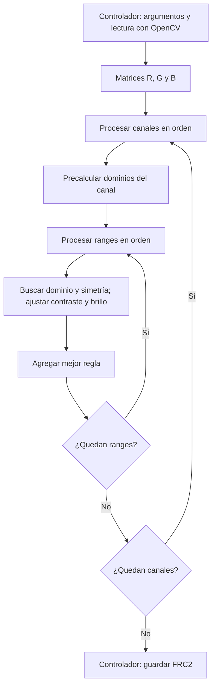
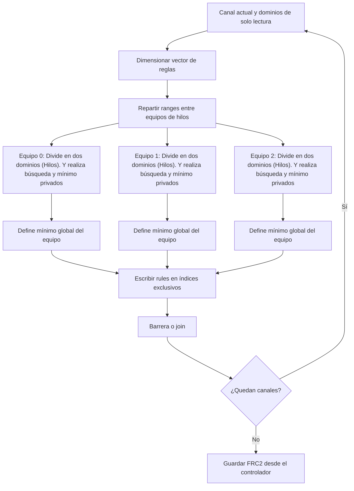

# Compresión Fractal RGB

**Avance 2**  
**CE 4302 — Arquitectura de Computadores II**  
**Instituto Tecnológico de Costa Rica (TEC)**  
**II Semestre — 2026**

---

## Resumen de navegación para la Demostración 2

Este proyecto implementa un compresor fractal de imágenes en C++17. La versión base procesa imágenes RGB mediante tres búsquedas independientes, conserva el modo de escala de grises y permite reconstruir imágenes a partir de archivos de reglas. El objetivo de la siguiente etapa es paralelizar la búsqueda para aprovechar un procesador multinúcleo de memoria compartida.

| # | Requerimiento de evaluación tomado de la referencia | Ubicación | Alcance de esta entrega |
|---|---|---|---|
| 1 | Identificación de variables y puntos de paralelización | Sección 1 de esta guía; [src/codec.cpp](src/codec.cpp) y [src/color.cpp](src/color.cpp) | Se identifican funciones, bucles y datos. Se incluyen comentarios sugeridos para insertar en el código. |
| 2 | Diagrama arquitectónico preliminar secuencial frente a paralelo | [Sección 2](#2-diagrama-arquitectónico-preliminar) de esta guía | Diagramas Mermaid integrados, sin depender de imágenes externas. |
| 3 | Dos propuestas comparadas por criterios | [docs/Propuestas.md](docs/Propuestas.md) | Asignación estática de ranges frente a asignación dinámica de grupos de ranges. |

---

## 1. Identificación de variables y puntos de paralelización

### A. Variables críticas del problema

| Variable o estructura | Ubicación | Función e impacto |
|---|---|---|
| `Image::width`, `Image::height` | `include/fractal/codec.hpp` | Determinan la cantidad de píxeles, ranges y dominios candidatos. |
| `Config::range` | `include/fractal/codec.hpp` | Lado del range; el dominio tiene lado `2*range`. Determina el tamaño de cada comparación y la cantidad de reglas. |
| `Config::stride` | `include/fractal/codec.hpp` | Desplazamiento entre dominios. Un paso menor aumenta los candidatos y el trabajo de búsqueda. |
| `MultiImage::planes` | `include/fractal/color.hpp` | Contiene un plano gris o tres planos en orden R, G y B. |
| `domains` | `encode(const Image&, Config)`, `src/codec.cpp` | Catálogo de dominios reducidos. Puede compartirse para lectura durante la búsqueda de un canal. |
| `target`, `meanR`, `bestError`, `best` | `encode(const Image&, Config)` | Datos de un range y su mejor coincidencia; deben ser privados para cada tarea. |
| `block`, `meanD`, `variance`, `covariance`, `s`, `b`, `error` | Búsqueda de candidatos en `src/codec.cpp` | Temporales del ajuste y la comparación; deben ser privados. |
| `Encoded::rules` | `include/fractal/codec.hpp` | Resultado de la codificación: una regla por range, en orden por filas. |
| `iterations`, `current`, `next` | `decode`, `src/codec.cpp` | Controlan la reconstrucción iterativa con dos buffers. |

Para ancho W, alto H, lado del range B y stride S:

- Ranges por canal: `N_R = (W/B)*(H/B)`.
- Dominios por canal: `N_D = (floor((W-2B)/S)+1)*(floor((H-2B)/S)+1)`.
- Ocho simetrías por dominio.
- Tres canales en RGB.
- Costo aproximado de búsqueda: `O(3*N_R*N_D*8*B²)`.

Ejemplo de conteo, no de rendimiento medido: para 128×128, B=8 y S=8, existen 256 ranges y 225 dominios por canal. Se evalúan `3*256*225*8 = 1 382 400` combinaciones range–dominio–simetría.

### B. Bucles paralelizables y cuello de botella esperado

1. **Canales:** el recorrido de `planes` en `encode(const MultiImage&, Config)`, dentro de `src/color.cpp`, procesa R, G y B independientemente. Es un punto sencillo de paralelización, pero usar solo este nivel limita el número de tareas a tres.
2. **Rangos:** los bucles `ry` y `rx` de `encode(const Image&, Config)`, dentro de `src/codec.cpp`, calculan reglas independientes. Este es el nivel principal propuesto. Además, los ranges se distribuirán entre equipos de hilos, permitiendo procesar varios bloques simultáneamente. La cantidad de equipos será configurable para comparar distintas distribuciones del trabajo.
3. **Dominios y simetrías:** los bucles sobre `domains` y `sym` también admiten descomposición. Dentro de cada equipo, los hilos se repartirán los dominios candidatos de un mismo range y evaluarán sus respectivas simetrías. Cada hilo conservará su mejor candidato y, al finalizar, se combinarán los mínimos locales para seleccionar una única regla. Así, cada range seguirá evaluándose contra todos los dominios, aunque la búsqueda esté distribuida.
4. **Decodificación:** dentro de una iteración, los ranges pueden calcularse en paralelo leyendo `current` y escribiendo regiones disjuntas de `next`. Las iteraciones consecutivas dependen entre sí y requieren una barrera antes de intercambiar los buffers.

El **cuello de botella esperado** es la búsqueda exhaustiva del codificador: reducción precalculada, transformación, ajuste y evaluación de candidatos. La transformación crea temporales repetidamente, lo que también puede afectar el rendimiento. Esta hipótesis debe verificarse con mediciones; no se atribuye el cuello de botella a la consola ni se reporta un perfil de ejecución inexistente.

### Ejemplo de distribución rangos / dominios esperada
| Equipo | Rangos asignados | Primer hilo | Segundo hilo |
|---|---|---|---|
| 0 | 0–19 | Dominios 0–99 | Dominios 100–199 |
| 1 | 20–39 | Dominios 0–99 | Dominios 100–199 |
| 2 | 40–59 | Dominios 0–99 | Dominios 100–199 |
| 3 | 60–79 | Dominios 0–99 | Dominios 100–199 |
| 4 | 80–99 | Dominios 0–99 | Dominios 100–199 |

---

## 2. Diagrama arquitectónico preliminar

### Sistema secuencial actual



### Sistema paralelo propuesto



El cambio principal es reemplazar el crecimiento secuencial de `rules` por un vector dimensionado antes del trabajo paralelo. `reserve` por sí solo no basta para escribir por índice: debe establecerse el tamaño mediante `resize`.

El formato y el orden de las reglas se conservan. La serialización ocurre después de reunir a los equipos. Los dos mecanismos de reparto se detallan en [Propuestas.md](docs/Propuestas.md).

---

## 3. Compilación y ejecución del sistema base

### Dependencias y compilación

Desde la raíz del proyecto, en Ubuntu, Linux Mint o Ubuntu dentro de WSL:

```bash
sudo apt update
sudo apt install build-essential cmake libopencv-dev
cmake -S . -B build -DCMAKE_BUILD_TYPE=Release -DBUILD_APP=ON
cmake --build build -j2
ctest --test-dir build --output-on-failure
```

`-j2` acelera la construcción con dos trabajos; no paraleliza el algoritmo. CMake genera la construcción y CTest ejecuta las pruebas registradas. Se mantiene C++17 y OpenCV con componentes `core` e `imgcodecs`.

### Demostración RGB

```bash
./build/fractal compress examples/color.png prueba_color.frc 8 8
./build/fractal decompress prueba_color.frc reconstruida_color.png 80
./build/fractal compare examples/color.png reconstruida_color.png
```

- Los dos últimos argumentos de `compress` son range y stride; el dominio tiene el doble del lado del range.
- `80` indica iteraciones de reconstrucción por canal; por defecto son 40.
- `compare` informa MSE y PSNR globales y por canal.
- Para una imagen propia, se sustituye la ruta por el nombre completo, incluida su extensión.

### Demostración en gris y compatibilidad

```bash
./build/fractal compress-gray examples/color.png prueba_gris.frc 8 8
./build/fractal decompress prueba_gris.frc reconstruida_gris.png 80
./build/fractal compare-gray examples/color.png reconstruida_gris.png
```

RGB usa `FRC2`; gris conserva `FRC1`. El decodificador nuevo reconoce ambos formatos. La extensión es `.frc` en los dos casos. OpenCV convierte su representación BGR a los planos RGB propios, y revierte ese orden al guardar.

### Salidas y evidencia

El programa informa canales, reglas por canal, bytes del archivo y relación contra píxeles sin comprimir. Mide codificación o decodificación sin E/S y tiempo total con E/S. La comparación contra píxeles no equivale a una comparación contra el tamaño del PNG/JPEG de entrada.

Se pueden ver benchmarks en [docs/images](docs/images) además de un ejemplo de la imagen original y la imagen descomprimida por el algoritmo.

### Restricciones actuales

Imágenes de 8 bits por canal al cargar; sin conservación de alfa ni metadatos. Los lados deben ser múltiplos del range, al menos dos veces ese lado y no superar 4096. Range admitido: 2 a 64. Se recomienda comenzar con 128×128; el límite de dimensiones no garantiza tiempos prácticos. La compresión es con pérdida y no garantiza archivos menores que PNG o JPEG.

---

## 4. Estructura del proyecto

| Ruta | Responsabilidad |
|---|---|
| `CMakeLists.txt` | Construcción de biblioteca, aplicación y pruebas. |
| `README.md` | Esta guía de evaluación. |
| `include/fractal/codec.hpp` | Datos y funciones para un canal. |
| `include/fractal/color.hpp` | Contenedores y operaciones multicanal. |
| `src/codec.cpp` | Reducción, simetrías, ajuste, búsqueda y reconstrucción. |
| `src/color.cpp` | Coordinación de canales RGB o gris. |
| `app/main.cpp` | Argumentos, llamadas y mediciones. |
| `app/image_io.hpp`, `app/image_io.cpp` | Adaptación de imágenes OpenCV. |
| `app/file_io.hpp`, `app/file_io.cpp` | Serialización gris FRC1. |
| `app/color_io.hpp`, `app/color_io.cpp` | Serialización multicanal y lectura FRC1/FRC2. |
| `tests/test_codec.cpp` | Pruebas del núcleo gris. |
| `tests/test_color.cpp` | Pruebas RGB y compatibilidad de archivos. |
| `tests/test_image_io.cpp` | Verificación del orden de canales con OpenCV. |
| `examples/` | Imágenes y códigos de referencia. |
| `docs/Propuestas.md` | Diseños de paralelización y comparación. |

## 5. Próxima etapa

Incorporar las marcas en código, implementar primero el reparto estático, verificar equivalencia con la versión secuencial y medir aceleración. Implementar después el reparto dinámico como alternativa experimental. El protocolo y la selección preliminar están en [docs/Propuestas.md](docs/Propuestas.md).
