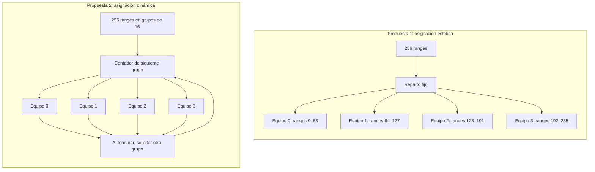

# Propuestas de Diseño de Paralelización — Compresión Fractal RGB

**CE 4302 — Arquitectura de Computadores II**  
**Instituto Tecnológico de Costa Rica (TEC)**  
**Avance 2 — II Semestre 2026**

El compresor procesa los canales rojo, verde y azul mediante búsquedas independientes. Para cada bloque pequeño (*range*), compara los dominios candidatos y sus ocho simetrías, ajusta contraste y brillo y guarda la regla con menor error.

Este documento conserva las alternativas de diseño estudiadas. La implementación final
concentra el trabajo en esta búsqueda y adopta el reparto estático entre equipos.
El [README](../README.md) contiene el estado y los resultados vigentes.

## 1. Propuesta 1: asignación estática de ranges

**Descripción:** los ranges se enumeran por filas y se reparten en grupos contiguos de tamaño similar. Cada equipo conoce desde el inicio los bloques que debe procesar; sus miembros se reparten los dominios de cada bloque y reducen sus mínimos locales. Los canales se procesan en orden R, G y B, aplicando el reparto dentro de cada canal.

**Sincronización:** los miembros de cada equipo reparten los dominios de su range,
esperan sus resultados y reducen mínimos antes de publicar la regla. Por ejemplo,
10 hilos forman 5 equipos de 2. CMP/SMT permiten búsqueda concurrente; Fine/Coarse
conservan ese reparto, pero sus turnos cooperativos serializan la búsqueda global.

**Escritura en memoria:** el vector de reglas se dimensiona con `resize` antes de iniciar los hilos. Un miembro designado del equipo publica la regla en el índice exclusivo de su range, tras reducir mínimos. La imagen y los dominios se comparten para lectura; el mejor candidato y los cálculos temporales son privados de cada hilo.

Esta distribución se adapta a la búsqueda exhaustiva actual: todos los ranges tienen el mismo tamaño y examinan la misma cantidad de dominios y simetrías, por lo que su carga de trabajo es aproximadamente uniforme.

## 2. Propuesta 2: asignación dinámica de grupos de ranges

**Descripción:** los ranges se organizan en grupos pequeños. Cuando un equipo termina su grupo, solicita otro y continúa hasta agotar el trabajo. La cantidad de grupos que procesa cada equipo depende de su avance; sus miembros reparten dominios y reducen mínimos por range.

**Sincronización:** un contador atómico indica el siguiente grupo disponible. Su actualización permite asignar grupos distintos a cada equipo, pero añade un costo de coordinación. También se espera a todos los hilos al finalizar el canal.

**Escritura en memoria:** se utiliza el mismo vector de reglas dimensionado previamente. Cada grupo tiene índices exclusivos, de modo que el orden de finalización no altera el orden de las reglas guardadas.

Esta alternativa resulta útil cuando unas tareas tardan más que otras. En nuestro algoritmo, esa diferencia es limitada porque la búsqueda recorre todos los candidatos. Tendría mayor interés si se incorporaran búsquedas con parada anticipada.

## 3. Esquema Comparativo de Descomposición

Ejemplo para un canal con 256 ranges y cuatro equipos (cada equipo reparte dominios internamente).

En la asignación estática, cada equipo conoce sus ranges desde el inicio.
En la dinámica, los equipos solicitan grupos hasta agotar el trabajo.
En ambos casos, cada range produce una regla en una posición exclusiva
del vector de resultados. El proceso se repite para R, G y B.

## 4. Ejemplo de distribución

Para un canal con 256 ranges y cuatro equipos:

| Equipo | Asignación estática | Asignación dinámica, en grupos de 16 |
|---|---|---|
| 0 | Ranges 0–63 | Recibe un grupo y solicita otro al terminar. |
| 1 | Ranges 64–127 | Recibe un grupo y solicita otro al terminar. |
| 2 | Ranges 128–191 | Recibe un grupo y solicita otro al terminar. |
| 3 | Ranges 192–255 | Recibe un grupo y solicita otro al terminar. |

En la asignación estática, el reparto queda definido antes de la búsqueda. En la dinámica, el contador entrega cada grupo una sola vez y el reparto final depende del avance de los hilos.

## 5. Comparación según criterios de arquitectura

| Criterio | Asignación estática | Asignación dinámica |
|---|---|---|
| **Balance de carga** | Adecuado para el trabajo aproximadamente uniforme de la búsqueda actual. | Puede compensar diferencias de duración entre tareas. |
| **Localidad de caché L1/L2** | Los ranges consecutivos favorecen accesos cercanos al leer sus píxeles y escribir reglas. | Conserva localidad dentro de cada grupo, pero puede cambiar de región al solicitar otro. |
| **Sincronización** | Coordinación del canal y reducción obligatoria de mínimos dentro de cada equipo por range. | Misma reducción por range; añade una operación atómica por grupo asignado. |
| **Memoria compartida** | Imagen y dominios de solo lectura; resultados en posiciones exclusivas. | Mismo esquema, más el contador de grupos. |
| **Complejidad** | Reparto sencillo y fácil de seguir durante la depuración. | Requiere gestionar la asignación y elegir el tamaño de los grupos. |

Ambas propuestas recorren el mismo catálogo de dominios. Si este supera la capacidad de las cachés, las dos pueden verse afectadas; la distribución por sí sola no garantiza una mejora de caché.

## 6. Selección y justificación del diseño

**Decisión aprobada (2026-10-13): asignación estática de ranges a equipos de hilos.**

Cada equipo procesa un range a la vez y reparte sus dominios candidatos entre los miembros.
Ejemplo: 10 hilos forman 5 equipos de 2; en CMP/SMT pueden buscar sobre 5 ranges simultáneamente.
Cada hilo evalúa las ocho simetrías de sus dominios y obtiene un mínimo local. El equipo
espera a sus miembros y reduce esos mínimos para publicar una única regla por range.
Los empates se resuelven por índice global de dominio y después por simetría, manteniendo
la regla que hubiera seleccionado la ejecución secuencial. Equipos e hilos por equipo son
configurables; la versión secuencial exige un equipo de un hilo.

La razón principal es que cada range realiza una búsqueda de tamaño similar: recorre los mismos dominios, prueba ocho simetrías y compara la misma cantidad de píxeles. Por ello, repartir una cantidad semejante de ranges entre los equipos permite distribuir el trabajo sin solicitar nuevas tareas durante la ejecución.

Además, los grupos contiguos de ranges facilitan accesos cercanos y escritura ordenada.
Cada hilo obtiene un candidato local del range del equipo. Es obligatorio combinar los mínimos
parciales antes de publicar la regla y pasar al siguiente range; también se espera a todos
los equipos al terminar el canal.

El vector `rules` se dimensiona previamente y se escribe por índice exclusivo. Los modelos concurrentes reutilizan esta disposición: los dominios se comparten para lectura y cada hilo mantiene sus temporales de búsqueda. Así se conserva el formato del archivo y el orden de las reglas.

La asignación dinámica queda como alternativa estudiada. Para la carga uniforme de esta versión, su coordinación adicional no ofrece una ventaja demostrada que justifique elegirla como diseño del proyecto. Las campañas físicas del diseño seleccionado ya están incorporadas en el [README](../README.md#resultados-físicos-incluidos); la alternativa dinámica no está implementada ni comparada experimentalmente.
