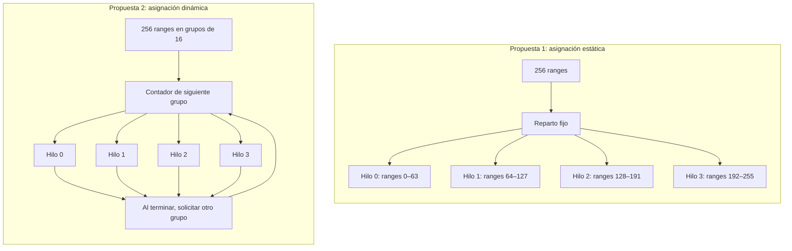

# Propuestas de Diseño de Paralelización — Compresión Fractal RGB

**CE 4302 — Arquitectura de Computadores II**  
**Instituto Tecnológico de Costa Rica (TEC)**  
**Avance 2 — II Semestre 2026**

El compresor procesa los canales rojo, verde y azul mediante búsquedas independientes. Para cada bloque pequeño (*range*), compara los dominios candidatos y sus ocho simetrías, ajusta contraste y brillo y guarda la regla con menor error.

La paralelización se concentrará en esta búsqueda. Se consideran dos formas de distribuir los ranges entre los hilos de un procesador multinúcleo con memoria compartida.

## 1. Propuesta 1: asignación estática de ranges

**Descripción:** los ranges se enumeran por filas y se reparten en grupos contiguos de tamaño similar. Cada hilo conoce desde el inicio los bloques que debe procesar y realiza la búsqueda completa para cada uno. Los canales se procesan en orden R, G y B, aplicando el reparto dentro de cada canal.

**Sincronización:** se quiere poder probar los casos en los que la paralelización no se dé solamente en los ranges sino también en los dominios. Por ejemplo si se dispone de 10 hilos se quiere hacer 5 ranges y el dominio se divide en 2 para usar los 10 hilos en un momento determinado y ver si eso mejora la eficiencia. Para este caso concreto si se necesita sincronización ya que considerando un "equipo" de 2 hilos para cada range, si uno de los hilos termina debe esperar al otro, para luego poder definir cual de los dos obtuvo el menor error y crear la regla respectiva.

**Escritura en memoria:** el vector de reglas se dimensiona con `resize` antes de iniciar los hilos. Cada hilo escribe en los índices correspondientes a sus ranges. La imagen y los dominios se comparten para lectura; el mejor candidato y los cálculos temporales son privados de cada hilo.

Esta distribución se adapta a la búsqueda exhaustiva actual: todos los ranges tienen el mismo tamaño y examinan la misma cantidad de dominios y simetrías, por lo que su carga de trabajo es aproximadamente uniforme.

## 2. Propuesta 2: asignación dinámica de grupos de ranges

**Descripción:** los ranges se organizan en grupos pequeños. Cuando un hilo termina su grupo, solicita otro y continúa hasta agotar el trabajo. La cantidad de grupos que procesa cada hilo depende de su avance.

**Sincronización:** un contador atómico indica el siguiente grupo disponible. Su actualización permite asignar grupos distintos a cada hilo, pero añade un costo de coordinación. También se espera a todos los hilos al finalizar el canal.

**Escritura en memoria:** se utiliza el mismo vector de reglas dimensionado previamente. Cada grupo tiene índices exclusivos, de modo que el orden de finalización no altera el orden de las reglas guardadas.

Esta alternativa resulta útil cuando unas tareas tardan más que otras. En nuestro algoritmo, esa diferencia es limitada porque la búsqueda recorre todos los candidatos. Tendría mayor interés si se incorporaran búsquedas con parada anticipada.

## 3. Esquema Comparativo de Descomposición

Ejemplo para un canal con 256 ranges y cuatro hilos.

En la asignación estática, cada hilo conoce sus ranges desde el inicio.
En la dinámica, los hilos solicitan grupos hasta agotar el trabajo.
En ambos casos, cada range produce una regla en una posición exclusiva
del vector de resultados. El proceso se repite para R, G y B.

## 4. Ejemplo de distribución

Para un canal con 256 ranges y cuatro hilos:

| Hilo | Asignación estática | Asignación dinámica, en grupos de 16 |
|---|---|---|
| 0 | Ranges 0–63 | Recibe un grupo y solicita otro al terminar. |
| 1 | Ranges 64–127 | Recibe un grupo y solicita otro al terminar. |
| 2 | Ranges 128–191 | Recibe un grupo y solicita otro al terminar. |
| 3 | Ranges 192–255 | Recibe un grupo y solicita otro al terminar. |

En la asignación estática, el reparto queda definido antes de la búsqueda. En la dinámica, el contador entrega cada grupo una sola vez y el reparto final depende del avance de los hilos.

## 5. Comparación según criterios de arquitectura

| Criterio | Asignación estática | Asignación dinámica |
|---|---|---|
| **Balance de carga** | Adecuado para el trabajo aproximadamente uniforme de la búsqueda actual. | Puede compensar diferencias de duración entre tareas. |
| **Localidad de caché L1/L2** | Los ranges consecutivos favorecen accesos cercanos al leer sus píxeles y escribir reglas. | Conserva localidad dentro de cada grupo, pero puede cambiar de región al solicitar otro. |
| **Sincronización** | Coordinación al inicio y al final del canal. También en medio durante la el cálculo de mínimos si el dominio se divide en grupos. | Añade una operación atómica por cada grupo asignado. |
| **Memoria compartida** | Imagen y dominios de solo lectura; resultados en posiciones exclusivas. | Mismo esquema, más el contador de grupos. |
| **Complejidad** | Reparto sencillo y fácil de seguir durante la depuración. | Requiere gestionar la asignación y elegir el tamaño de los grupos. |

Ambas propuestas recorren el mismo catálogo de dominios. Si este supera la capacidad de las cachés, las dos pueden verse afectadas; la distribución por sí sola no garantiza una mejora de caché.

## 6. Selección y justificación del diseño

**Implementaremos la Propuesta 1: asignación estática de ranges.**

La razón principal es que cada range realiza una búsqueda de tamaño similar: recorre los mismos dominios, prueba ocho simetrías y compara la misma cantidad de píxeles. Por ello, repartir una cantidad semejante de ranges entre los hilos permite distribuir el trabajo sin solicitar nuevas tareas durante la ejecución.

Además, los grupos contiguos facilitan el acceso a los píxeles cercanos y la escritura ordenada de resultados. Cada hilo obtiene una regla completa por range, por lo que no es necesario combinar mínimos parciales entre trabajadores. El único encuentro obligatorio al terminar la búsqueda del canal es la espera de todos los hilos.

Para implementarlo, se sustituirá el crecimiento de `rules` mediante `push_back` por un vector dimensionado previamente y escrituras en índices exclusivos. Los dominios permanecerán disponibles para lectura y cada hilo tendrá sus propios temporales de búsqueda. Así se conserva el formato del archivo y el orden de las reglas.

La asignación dinámica queda como alternativa estudiada. Para la carga uniforme de esta versión, su coordinación adicional no ofrece una ventaja que justifique elegirla como diseño del proyecto. La selección está definida; la aceleración obtenida se determinará al ejecutar la implementación paralela.
