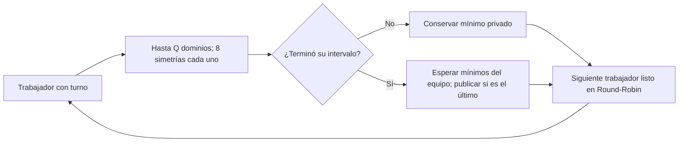

# Fine-Grained: planificación cooperativa de la búsqueda fractal

## Referencia y alcance

Se adapta el enfoque cooperativo de [RayTracing](../../../echavarria/RayTracing/fine-grained/main.cpp):
cuantum mínimo configurable y rotación incondicional tras cada trozo de trabajo. Su variante
cooperativa utiliza hilos virtuales; aquí se utilizan pthreads reales y turnos verificados mediante
mutex y condición para cumplir los criterios de la etapa 2. La variante paralela cíclica de
RayTracing no impone alternancia estricta y no se incorpora como un segundo modelo.

El cuantum por defecto equivale a **1 dominio candidato y sus ocho simetrías**. Se configura
con `--quantum-domains N` (N positivo). No se divide la aritmética de un candidato ni se altera
la compresión, las reglas, los formatos FRC1/FRC2 o el orden de desempate secuencial.

## Equipos, turnos y sincronización

1. Se prepara el catálogo de dominios del canal mediante el núcleo compartido.
2. Los ranges se reparten en grupos contiguos equilibrados entre equipos.
3. Cada equipo procesa un range a la vez; sus miembros se reparten dominios contiguos,
   incluyendo las ocho simetrías de cada dominio. Sus mejores candidatos son privados.
4. Se crean `teams * threads_per_team` pthreads antes de abrir la compuerta de inicio.
5. El trabajador con turno realiza hasta N dominios y entrega el turno al siguiente listo
   en orden circular global. Si todavía tiene dominios, espera su próxima vuelta.
6. Un miembro que acaba su intervalo espera a los demás miembros del equipo. El último
   reduce sus mínimos con `best_candidate`, publica una regla por índice y habilita a
   los miembros para el siguiente range del equipo.
7. Se omiten miembros con intervalos vacíos y equipos que terminaron. Al finalizar todos,
   se despiertan las esperas y se reúne cada pthread con `pthread_join`.

El mutex protege estados de equipos, turno, resultados y traza y se mantiene durante el
cuantum: **solo un trabajador realiza búsqueda a la vez**. `pthread_cond_wait` libera el
mutex y bloquea, sin espera activa. Cada trabajador tiene una condición propia: después
de elegir el siguiente turno se utiliza `pthread_cond_signal` únicamente sobre esa condición.
Si continúa el mismo trabajador, no se envía una señal. La apertura inicial también avisa
solo al elegido; el predicado bajo mutex evita perder un turno si el hilo todavía no esperaba.
Al finalizar o ante un error se señalan todas las condiciones para permitir los joins,
incluidos miembros sin dominios y equipos terminados. Las condiciones se inicializan antes
de crear hilos y se destruyen después de reunirlos; la inicialización parcial libera sus recursos.
La barrera del equipo se expresa mediante su contador
de miembros pendientes; no se usa una barrera bloqueante que pudiera retener el turno.
Los canales se procesan en orden, con un planificador por canal.

Ante fallo de creación se detienen y reúnen todos los pthreads ya creados antes de propagar
el error. Las excepciones de búsqueda, preparación del siguiente range o registro de traza
se capturan dentro del trabajador, detienen el planificador y se propagan tras los joins.



## Ejecución y traza

Desde la raíz de `fractal-cpp`, tras compilar:

```bash
mkdir -p fine-grained/results
./build/fractal_fine compress sequential/examples/color128.png fine-grained/results/color.frc --teams 5 --threads-per-team 2 --quantum-domains 1
./build/fractal_seq decompress fine-grained/results/color.frc fine-grained/results/color.png --iterations 80
./build/fractal_seq compare sequential/examples/color128.png fine-grained/results/color.png
```

Para inspeccionar los turnos, agregar `--trace-schedule fine-grained/results/schedule.csv`
al comando de compresión. Cada fila registra `channel,worker,team,range,domain_begin,domain_end`;
el intervalo es semiabierto y no vacío. El registro es opcional, ocupa memoria proporcional
al número de cuantums y altera el tiempo de cómputo; no usarlo como benchmark principal.
Desde C++, `ExecutionConfig::schedule_trace` recibe un vector del llamador y añade eventos
en orden de ejecución. El vector debe permanecer vivo y reservado al llamador durante la llamada.

La reconstrucción permanece secuencial: usar `fractal_seq decompress`.
`fractal_fine` fija Fine-Grained y rechaza la reconstrucción. Su main delega en `app/cli.cpp`. La etapa 2 se concentra en la búsqueda del codificador.

## Validación y límites

`fine_grained_tests` compara reglas campo por campo y reconstrucciones exactas frente a la base.
Reproduce el protocolo desde la traza para comprobar orden circular, cobertura sin huecos,
cuantums acotados y finalización de cada equipo antes de cambiar de range. Incluye constantes
con empates, patrones rectangulares, particiones desiguales, intervalos vacíos, más equipos que
ranges, 1×1, 1×3, 5×2, 6×4 y 7×4 trabajadores, Q=1/2/100 y tres canales.

`cli_tests` compara FRC de gris/RGB para 5×2 trabajadores y Q=1/3/100, comprueba las trazas,
reconstrucción y rechazo de cuantums inválidos y rutas de traza que colisionen con entrada/salida.
CTest limita a 45 segundos la prueba del planificador para detectar bloqueos.

Esta simulación cooperativa no reproduce alternancia por ciclo del hardware ni mide cambios
de contexto del SO. Puede ser más lenta que la base debido a pthreads, mutex y despertares.
No implementa afinidad, CMP, SMT, Coarse-Grained, métricas de hardware ni benchmarks de la etapa 7.
Los resultados reales y cualquier limitación de herramientas se registran en el README principal.
