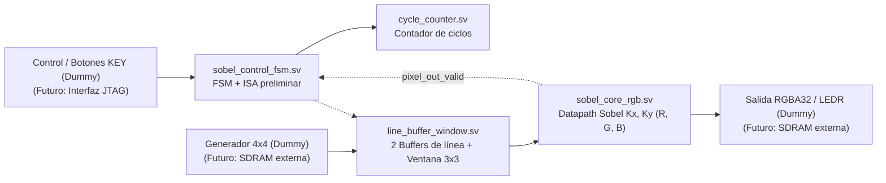
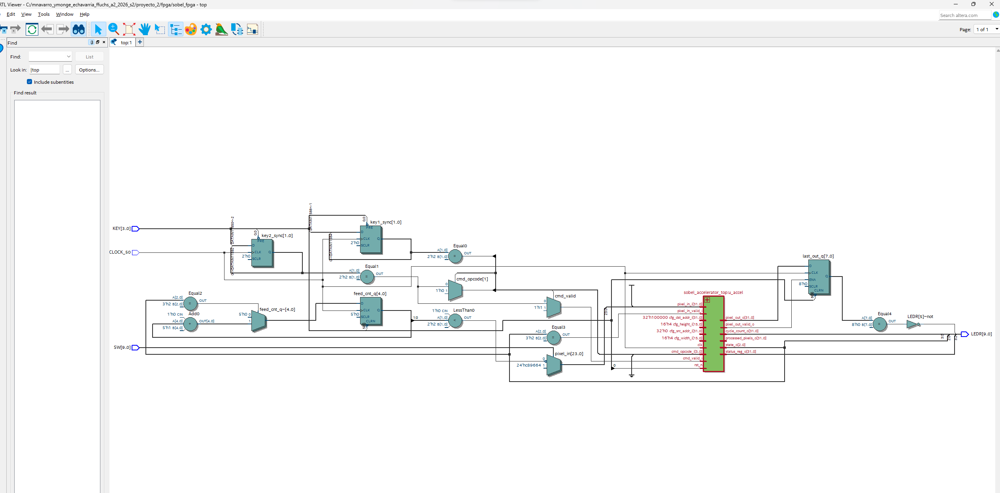
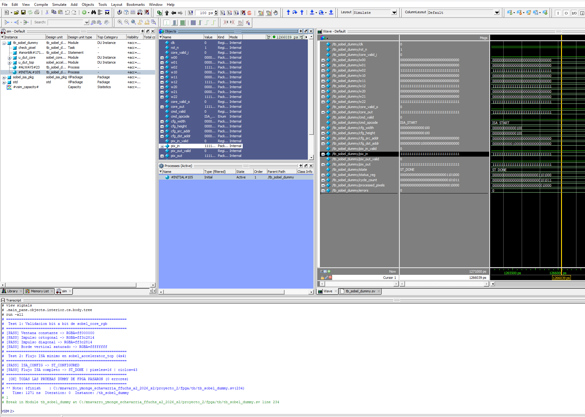
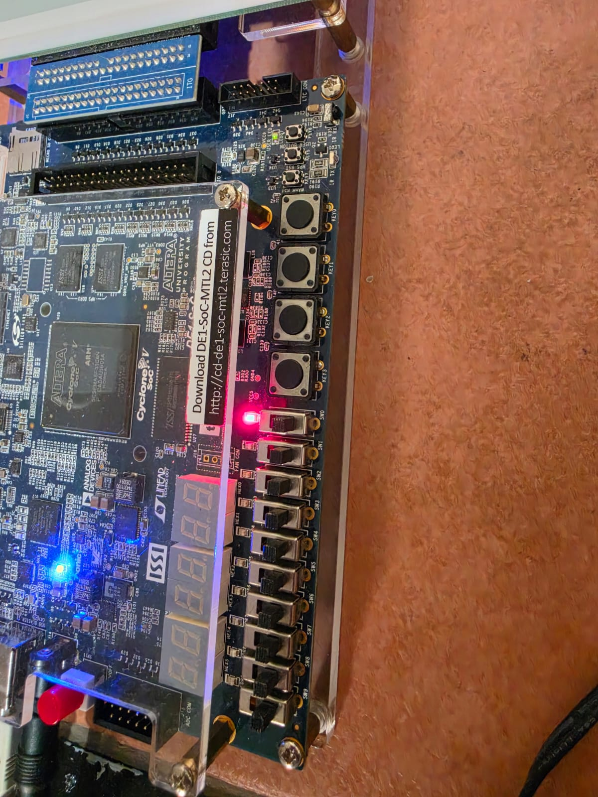
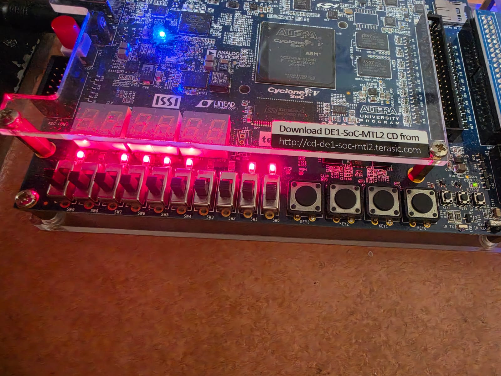
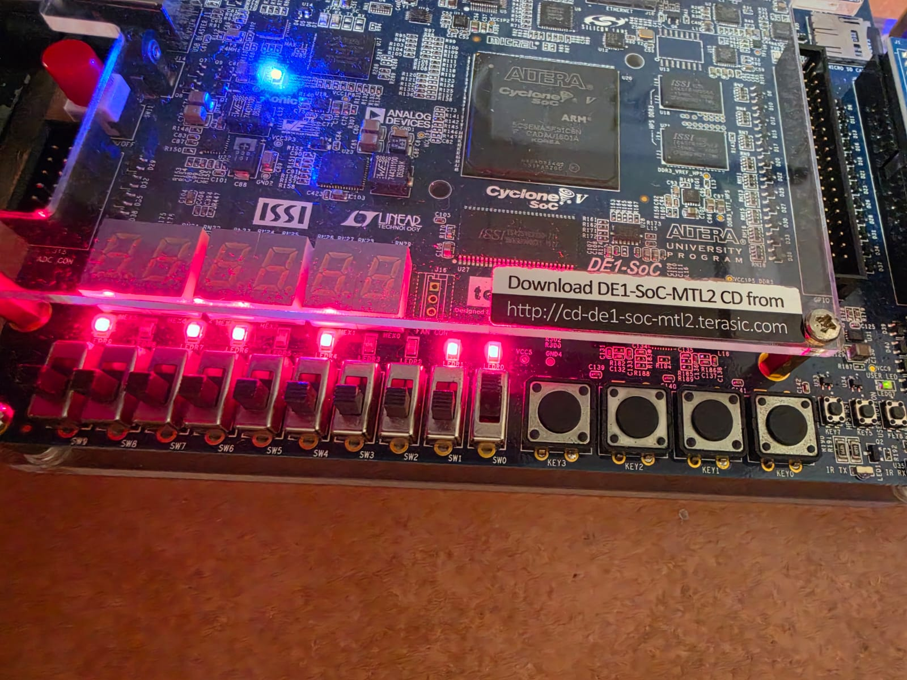

# Módulo FPGA (`fpga/`) — Acelerador Sobel RGBA32 (Prototipo *Dummy* — Avance 2)

> **Estado actual (Avance 2):** Esta implementación corresponde a un **prototipo *dummy* funcional** diseñado para validar la arquitectura modular, la síntesis en **Terasic DE1-SoC (Cyclone V SoC — `5CSEMA5F31C6`)**, la simulación del datapath y el flujo básico en placa física. **No procesa todavía imágenes reales desde SDRAM/JTAG** y el **ISA mínimo aquí definido es preliminar** (sujeto a refinamiento al integrar la interfaz de transferencia en la entrega final).

---

## 1. Arquitectura de módulos



### Resumen de archivos

| Archivo | Rol / Descripción breve |
| :--- | :--- |
| `rtl/sobel_isa_pkg.sv` | Paquete con la definición **preliminar** del ISA mínimo, estados de la FSM, bits de `STATUS` y funciones auxiliares RGBA32 little-endian (`[R, G, B, A]`). |
| `rtl/sobel_control_fsm.sv` | FSM de control (`ST_IDLE → ST_CONFIGURED → ST_RUN → ST_DONE` / `ST_ERROR`) que decodifica los comandos del ISA, valida dimensiones y coordina datapath y contador. |
| `rtl/cycle_counter.sv` | Contador de ciclos de 32 bits activo únicamente en `ST_RUN` para medir el cómputo sin sesgo de transferencias JTAG. |
| `rtl/line_buffer_window.sv` | Estructura base de 2 *buffers* de línea y matriz de registros $3 \times 3$ a razón de 1 píxel/ciclo *(versión dummy: falta lógica completa de zero-padding en bordes y lectura síncrona para inferencia BRAM)*. |
| `rtl/sobel_core_rgb.sv` | Datapath segmentado (2 etapas de *pipeline*) que calcula $K_x, K_y$ en paralelo sobre R, G y B usando sumas y desplazamientos (sin multiplicadores), magnitud Manhattan saturada a 8 bits y `A = 255` (exacto bit a bit con `sobel_sequential`). |
| `rtl/sobel_accelerator_top.sv` | Módulo integrador que conecta la FSM, el contador de ciclos, los *buffers* de línea y el núcleo Sobel. |
| `rtl/top.sv` | Top-level *dummy* para la placa **DE1-SoC**: reemplaza temporalmente a JTAG y SDRAM usando `CLOCK_50`, botones `KEY[2:0]`, `SW[0]` y `LEDR[9:0]` con un patrón sintético `4×4`. |
| `tb/tb_sobel_dummy.sv` | *Testbench* de simulación para ModelSim (no sintetizable): valida `sobel_core_rgb` contra casos del baseline y prueba el flujo ISA completo en `sobel_accelerator_top`. |
| `sobel_fpga.qpf` / `top.qsf` | Archivos de proyecto de Quartus Prime 20.1.1 (dispositivo `5CSEMA5F31C6`, lista de fuentes `.sv`, asignación de pines de la DE1-SoC y configuración NativeLink). |

---

## 2. ISA Mínimo (Preliminar)

Definido en `rtl/sobel_isa_pkg.sv` con base en la propuesta del Avance 1 (`CONFIG`/`START`/`STATUS`). **Es preliminar** y podrá ampliarse con registros de transferencia/DMA al conectar JTAG y SDRAM.

| Opcode | Comando | Descripción |
| :--- | :--- | :--- |
| `4'h0` | `ISA_NOP` | Sin operación. |
| `4'h1` | `ISA_CONFIG` | Carga `width`, `height` y direcciones base (`src`/`dst`). Pasa a `ST_CONFIGURED` (o `ST_ERROR` si `W=0` o `H=0`). |
| `4'h2` | `ISA_START` | Limpia datapath y contador de ciclos, e inicia el procesamiento (`ST_RUN`). |
| `4'h3` | `ISA_STATUS` | Expone `status_reg_o` (`IDLE`, `CONFIGURED`, `BUSY`, `DONE`, `ERROR`) y `cycle_count_o`. |
| `4'hF` | `ISA_RESET` | Reinicio por software de la FSM, *buffers* y contadores. |

---

## 3. Requisitos y notas de entorno (Windows)

- **Herramientas:** **Intel Quartus Prime Lite Edition 20.1.1** con soporte para **Cyclone V** y **ModelSim - Intel FPGA Starter Edition** (incluido sin licencia).
- **Rutas cortas y sin espacios:** Clona/trabaja el repositorio en una ruta corta fuera de OneDrive (por ejemplo `C:\mnavarro_ymonge_echavarria_ffuchs_a2_2026_s2\proyecto_2\fpga`). Rutas largas, espacios o sincronización activa de OneDrive provocan errores de permisos o fallos al compilar/programar en Quartus.
- **Windows 11 Smart App Control:** Si el Fitter (`quartus_fit`) falla inesperadamente por bloqueo de `comp_fit2.dll`, es necesario desactivar *Smart App Control* o utilizar una versión más reciente de Quartus con DLLs firmadas.

---

## 4. Cómo compilar en Quartus Prime

1. Abre **Quartus Prime 20.1 Lite Edition** *(el IDE principal, no el Programmer)*.
2. Ve a **File → Open Project...** y selecciona `sobel_fpga.qpf`.
3. *(Opcional)* Para explorar los archivos, cambia el panel izquierdo (**Project Navigator**) de *Hierarchy* a **Files**.
4. Haz clic en **Compile Design** (botón azul de Play) o ejecuta **Processing → Start Compilation**.
   - Esto corre *Analysis & Synthesis*, *Fitter*, *Assembler* y genera `output_files/top.sof`.
5. *(Opcional)* Para inspeccionar el diagrama de bloques generado por síntesis, abre **Tools → Netlist Viewers → RTL Viewer**.

---

## 5. Cómo simular el *testbench* en ModelSim

### Opción A: Directo desde Quartus (NativeLink)
1. Verifica una sola vez en **Tools → Options... → EDA Tool Options** que **ModelSim-Altera** apunte a:
   `C:\intelFPGA_lite\20.1\modelsim_ase\win32aloem`
2. Asegúrate de haber corrido al menos **Analysis & Synthesis**.
3. Ve a **Tools → Run Simulation Tool → RTL Simulation**.
   - Quartus abrirá ModelSim automáticamente, compilará los `.sv` + `tb/tb_sobel_dummy.sv`, ejecutará la simulación y abrirá las ondas (*Wave*).

### Opción B: Desde la consola (Transcript) de ModelSim
```tcl
cd C:/mnavarro_ymonge_echavarria_ffuchs_a2_2026_s2/proyecto_2/fpga
vlib work
vlog -sv rtl/sobel_isa_pkg.sv rtl/cycle_counter.sv rtl/sobel_control_fsm.sv rtl/line_buffer_window.sv rtl/sobel_core_rgb.sv rtl/sobel_accelerator_top.sv tb/tb_sobel_dummy.sv
vsim -voptargs=+acc work.tb_sobel_dummy
run -all
```

### Resultado esperado en Transcript
```text
[PASS] Ventana constante       -> RGBA=ff000000
[PASS] Impulso ortogonal       -> RGBA=ff3c2814
[PASS] Impulso diagonal        -> RGBA=ff3c2814
[PASS] Borde vertical saturado -> RGBA=ffffffff
[PASS] ISA_CONFIG              -> ST_CONFIGURED
[PASS] Flujo ISA completo      -> ST_DONE | pixeles=16 | ciclos=43
[OK] TODAS LAS PRUEBAS DUMMY DE FPGA PASARON (0 errores)
```

---

## 6. Cómo quemar el diseño en la DE1-SoC y probar el *dummy*

### Programación vía JTAG
1. Conecta el cable USB al puerto **USB-Blaster II** de la DE1-SoC y enciende la placa.
2. En Quartus abre **Tools → Programmer** *(o **Program Device** en Tasks)*.
3. Haz clic en **Hardware Setup...** → selecciona **`DE-SoC [USB-1]`** → **Close**.
4. Haz clic en **Auto Detect** → selecciona **`5CSEMA5`** → **OK** *(aparecerán dos dispositivos: `SOCVHPS` y `5CSEMA5F31`)*.
5. Haz clic derecho sobre **`5CSEMA5F31`** → **Change File...** → elige `output_files/top.sof`.
6. Marca la casilla **Program/Configure** en la fila de `5CSEMA5F31` y presiona **Start** (debe llegar a `100% (Successful)`).

### Prueba funcional *dummy* en la placa

| Control / Indicador | Función en `top.sv` |
| :--- | :--- |
| `KEY[0]` | **Reset** (activo en bajo) → regresa a `ST_IDLE`. |
| `KEY[1]` | Envía **`ISA_CONFIG`** (configura frame *dummy* `4×4`). |
| `KEY[2]` | Envía **`ISA_START`** (ejecuta el patrón y mide ciclos). |
| `SW[0]` | Selector de patrón: `0` = borde vertical, `1` = imagen constante. |
| `LEDR[2:0]` | Estado de la FSM (`000` IDLE, `001` CONFIGURED, `010` RUN, `011` DONE, `100` ERROR). |
| `LEDR[3]` / `LEDR[4]` | Banderas `BUSY` y `DONE`. |
| `LEDR[5]` | `1` si el último píxel de salida detectó borde (`R > 0`), `0` si el gradiente fue cero. |
| `LEDR[9:6]` | 4 bits bajos del contador de ciclos (`cycle_count[3:0]`). |

**Secuencia de verificación paso a paso:**
1. Presionar **`KEY[0]`** → todos los `LEDR[9:0]` se apagan (`ST_IDLE`).
2. Presionar **`KEY[1]`** → se enciende `LEDR[0]` (`ST_CONFIGURED`).
3. Dejar **`SW[0] = 0`** (borde vertical) y presionar **`KEY[2]`** → se encienden `LEDR[1:0]` (`ST_DONE`), `LEDR[4]` (`DONE`), **`LEDR[5]` (borde detectado)** y `LEDR[9:6] = 1011` (bits bajos de `43` ciclos).
4. Subir **`SW[0] = 1`** (imagen constante) y presionar **`KEY[2]`** → **`LEDR[5]` se apaga** (gradiente `0`), manteniendo `ST_DONE`, `DONE` y el conteo de ciclos.

---

## 7. Evidencias y pruebas de ejecución del *dummy*

### Síntesis RTL (Quartus Prime — RTL Viewer)
Esquemático generado tras *Analysis & Synthesis* de `top.sv`, mostrando los sincronizadores de botones, el generador de estímulos `4×4`, la instancia del acelerador `sobel_accelerator_top` y el mapeo hacia `LEDR[9:0]`:



### Simulación funcional (ModelSim — `tb_sobel_dummy.sv`)
Validación en simulación de los 4 casos bit a bit de `sobel_core_rgb` (constante, impulso ortogonal, impulso diagonal y borde saturado) y del flujo completo del ISA preliminar (`ISA_CONFIG → ISA_START → ST_DONE` con `16` píxeles en `43` ciclos, `0` errores):



### Pruebas físicas en la placa Terasic DE1-SoC

1. **Estado `ST_CONFIGURED` tras `KEY[1]` (`ISA_CONFIG`):** `LEDR[0]` encendido (`001`), confirmando carga de dimensiones `4×4`.

   

2. **Ejecución con borde vertical (`SW[0] = 0` + `KEY[2]` / `ISA_START`):** pasa a `ST_DONE` (`LEDR[1:0] = 11`, `LEDR[4] = 1`), **`LEDR[5] = 1`** confirmando detección de borde, y `LEDR[9:6] = 1011` (4 bits bajos de los `43` ciclos medidos).

   

3. **Ejecución con imagen constante (`SW[0] = 1` + `KEY[2]` / `ISA_START`):** mantiene `ST_DONE`, `DONE` y `LEDR[9:6] = 1011` (`43` ciclos), mientras **`LEDR[5]` se apaga (`0`)** confirmando gradiente cero sin falsos bordes.

   
